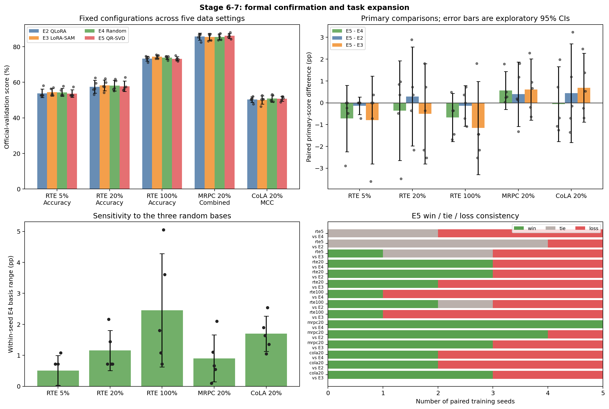

# QR-SVD：量化残差引导的 SAM 扰动实验

本项目检验一个问题：**量化残差所提供的低维方向，能否比同维随机方向构造更有效的 SAM 扰动？**

工程包含两条实验路线：CIFAR-100 上的低比特全参数 QAT，以及 RoBERTa-base 上的冻结 NF4 主干 + LoRA。两者共享研究问题，但量化方式、可训练参数、扰动空间和评价指标不同，不能直接横向比较精度。

## 方法与对照

记进入量化器的有效浮点权重与量化权重之差为量化残差 $R=W_s-W_q$。在量化权重梯度 $G$ 上比较：

- **原始 SAQ / LoRA-SAM**：分别在原 SAQ 或 LoRA 参数空间中构造扰动。
- **QR 输出子空间**：CIFAR 路线对初始残差做 QR 分解，保留前 $r$ 列正交基，以 $BB^\top G$ 构造权重扰动。
- **SVD 配对模式**：对残差做 SVD，取模式 $D_j=u_jv_j^\top$，以 $\sum_{j=1}^{r}\langle G,D_j\rangle_FD_j$ 构造扰动。
- **随机对照**：匹配相应的子空间维度或配对模式结构，分离“限制扰动空间”与“量化残差方向”本身的作用。

当前残差基在初始化后固定。QR 输出子空间保留约 $rn$ 个自由度，SVD 配对模式只有 $r$ 个坐标，不能仅凭相同 `rank=8` 将两者视为同容量实验。RoBERTa 方法中的 `QR` 指 *quantization residual*，E5 实际使用残差 SVD 模式。

## CIFAR-100：PreResNet-20 / W4A4

完整实现与运行入口见 [cifar100](cifar100/README.md)。固定设置为 CIFAR-100、PreResNet-20、主干 W4A4（首层 W8A32、末层 W8A8）、rho=0.4、200 epoch、batch 128。原始 SAQ 使用[基础复现项目](../SAQ-Reproduction/README.md)的历史记录。

| 方法 | 训练 seed 数 | 最佳测试 Top-1 | 末轮 Top-1 |
|---|---:|---:|---:|
| 原始 SAQ（历史基线） | 3 | **68.063 ± 0.068%** | **67.543 ± 0.385%** |
| RS-SAQ：随机输出子空间 | 3 | 67.783 ± 0.061% | 67.380 ± 0.174% |
| QR-SAQ：残差 QR 输出子空间 | 3 | 67.783 ± 0.060% | 67.230 ± 0.287% |
| SVD-RS-SAQ：随机配对模式 | 3 | 67.837 ± 0.228% | 67.433 ± 0.119% |
| SVD-QR-SAQ：残差 SVD 配对模式 | 1 | 67.700% | 67.300% |

`±` 表示跨训练 seed 的样本标准差；单 seed 不报告标准差。两个扩展阶段共归档 10 次完整训练，原始 SAQ 基线不重复计入新增实验。

**结论：** 当前固定 rank-8 设置中，残差 QR 与随机输出子空间基本持平；残差 SVD 模式也未优于结构匹配随机模式或原始 SAQ。诊断显示，捕获更多量化残差能量并未转化为稳定的测试精度收益。SVD-QR 目前只有一个 seed，不能据此判断总体均值或统计显著性。

详细结果：[QR 子空间报告](cifar100/reports/qr_subspace_report.md)、[SVD 配对模式报告](cifar100/reports/svd_modes_report.md)、[机器可读 SVD 汇总](cifar100/reports/figures/svd_qr_saq/method_summary.csv)。另保留[FP32/PTQ 对照及记录差异说明](cifar100/reports/ptq_baseline.md)，不将缺少对应产物的历史数值当作已核验结果。

## RoBERTa-base：NF4 + LoRA / GLUE

完整实现与环境说明见 [robertabase](robertabase/README.md)。模型主干以 4-bit NF4 冻结，训练 LoRA（rank 8、alpha 16、query/value）与分类头；分类头不施加 SAM 扰动。

| 标识 | 方法 | 正式配置 |
|---|---|---|
| E2 | QLoRA + AdamW | 无 SAM |
| E3 | LoRA 参数 A/B 空间 SAM | rho=0.01 |
| E4 | 随机配对模式子空间 SAM | rho=0.05，rank=8，谱权重 p=0 |
| E5 | 残差 SVD 配对模式 SAM | rho=0.05，rank=8，谱权重 p=0 |

归档 316 次已完成运行，包括初始对照、诊断、确定性重复、超参数搜索及 **150 次 Stage 6–7 正式确认**。它们不是 316 个独立正式种子。

正式确认使用训练/data seeds `13、21、42、87、100`；E4 每个训练 seed 运行三个 basis seeds `12345、2026、3407`，先在同一训练 seed 内平均，再与 E5 配对。因此每个 setting 共 30 次运行、5 个独立训练 seed。

下表为 **official-validation 主指标 × 100** 的均值 ± 样本标准差。RTE 使用 Accuracy，MRPC 使用 `(Accuracy+F1)/2`，CoLA 使用 MCC。

| Setting | E2 QLoRA | E3 LoRA-SAM | E4 Random | E5 QR-SVD | E5−E4（百分点） |
|---|---:|---:|---:|---:|---:|
| RTE 5% | 53.79 ± 2.42 | **54.44 ± 2.08** | 54.37 ± 2.31 | 53.65 ± 2.10 | −0.72 |
| RTE 20% | 57.47 ± 3.61 | **58.27 ± 2.97** | 58.12 ± 3.04 | 57.76 ± 2.92 | −0.36 |
| RTE 100% | 73.36 ± 1.36 | **74.37 ± 1.02** | 73.89 ± 1.02 | 73.21 ± 1.18 | −0.67 |
| MRPC 20% | 85.72 ± 1.96 | 85.51 ± 1.93 | 85.55 ± 1.70 | **86.12 ± 1.44** | +0.56 |
| CoLA 20% | 50.31 ± 1.57 | 50.07 ± 2.28 | **50.82 ± 1.94** | 50.76 ± 1.33 | −0.07 |



**结论：** E5 未表现出跨任务稳定优于 E4、QLoRA 或 LoRA-SAM 的优势。MRPC 的 E5−E4 在 5 个 seed 上均为正，但均值仅 +0.56 个百分点，探索性 95% 区间为 `[-0.30, 1.43]`；五个 setting 的 E5−E4 区间均跨 0。E5 的训练时间约为 E2 的 1.61–2.15 倍，与 E4 接近。

正式结果使用 official validation 进行 early stopping、最佳 checkpoint 选择和报告，不能解释为隐藏 test 集成绩。详细证据见[最终报告](robertabase/reports/param_tuning/stage6-7-正式确认与任务扩展.md)、[实验阶段索引](robertabase/reports/param_tuning/experiment_index.md)、[原始聚合 JSON](robertabase/records/stage67_formal_matrix_20261008_085232/stage67_aggregate.json)。

## 项目布局与复现入口

两个子项目分别维护依赖与环境。CIFAR 和 RoBERTa 原训练环境不同，建议独立安装；数据集、基础模型、训练权重及缓存均需另行准备。

```text
Quantization-SAM/
├── SAQ-Reproduction/            # CIFAR 基线记录
└── QR-SVD/
    ├── cifar100/
    │   ├── scripts/, analysis/, tests/
    │   ├── core/, models/, quan_models/, utils/
    │   └── records/, reports/
    └── robertabase/
        ├── src/, configs/, scripts/, analysis/, tests/
        └── records/, reports/
```

归档结果的重分析不需要模型权重或重新训练：

```bash
# 从仓库根目录进入 CIFAR 子项目，按该项目说明安装依赖后运行
cd QR-SVD/cifar100
python analysis/plot_projected_qsam_curves.py
python analysis/plot_projected_qsam_diagnostics.py
python analysis/plot_svd_qr_saq_results.py

# 在 RoBERTa 子项目的独立环境中，按其说明安装后运行
cd ../robertabase
python analysis/run_archived_analysis.py
```

CIFAR 绘图默认读取 `../../SAQ-Reproduction/records/`；单独下载子项目时可使用 `--saq-root` 指定基线位置。新运行写入被忽略的 `runs/` 或 `outputs/`，已归档 `records/` 保持可提交。RoBERTa 原始 JSON/JSONL 的完整性清单见 [checksums.json](robertabase/records/checksums.json)。

## 来源与许可

CIFAR 实现保留 SAQ 的 Apache-2.0 [LICENSE](cifar100/LICENSE) 和 [NOTICE](cifar100/NOTICE.md)。RoBERTa 项目的参考来源、QLoRA MIT 许可及自有代码许可说明见 [NOTICE](robertabase/NOTICE.md)。本目录未对两条工程的自有代码统一新增许可证。
