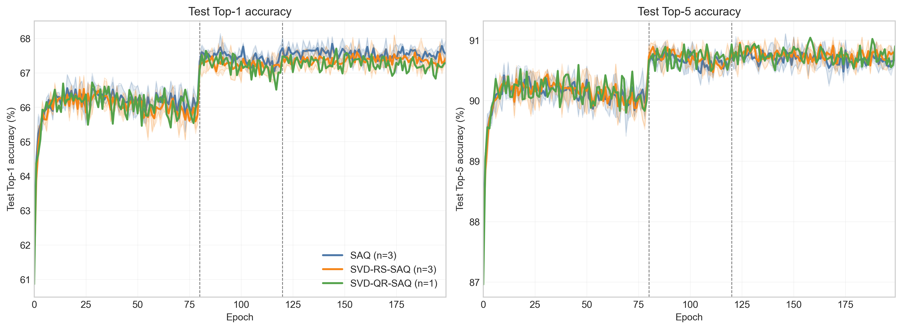
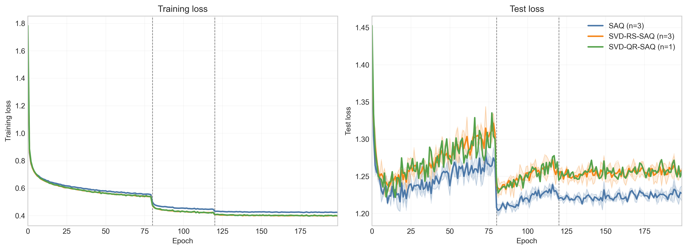
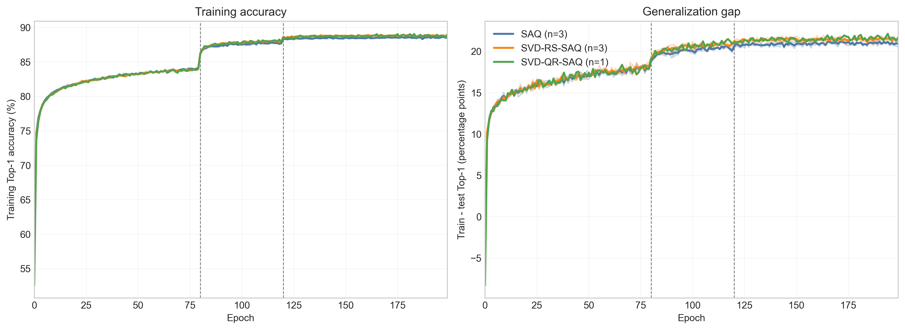
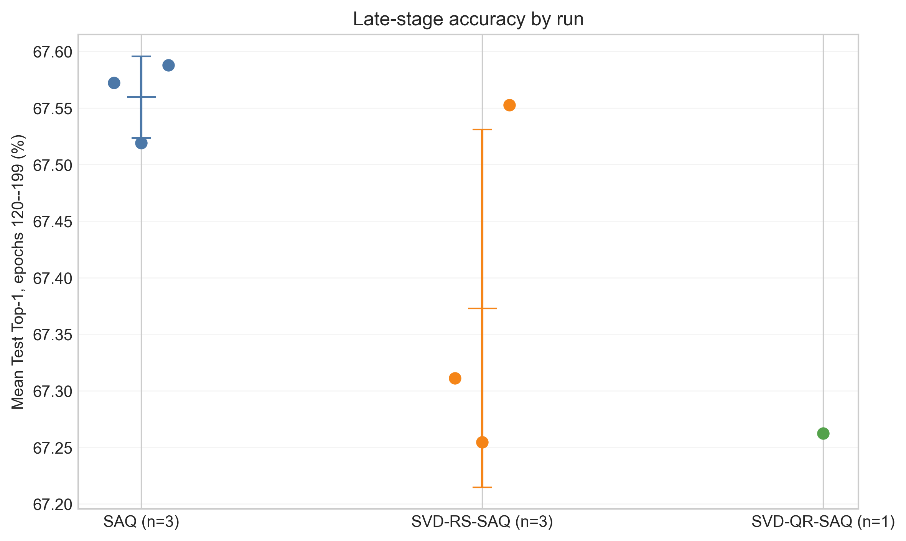
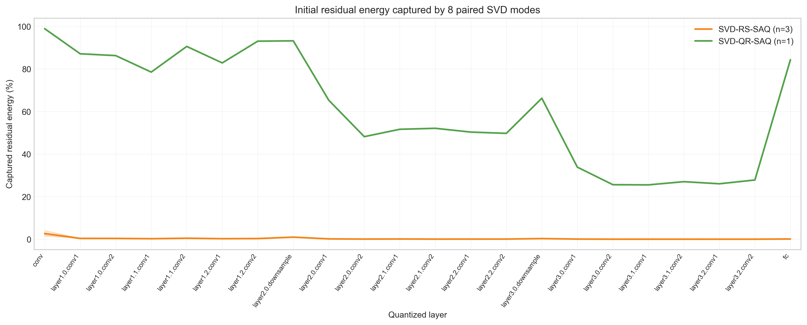
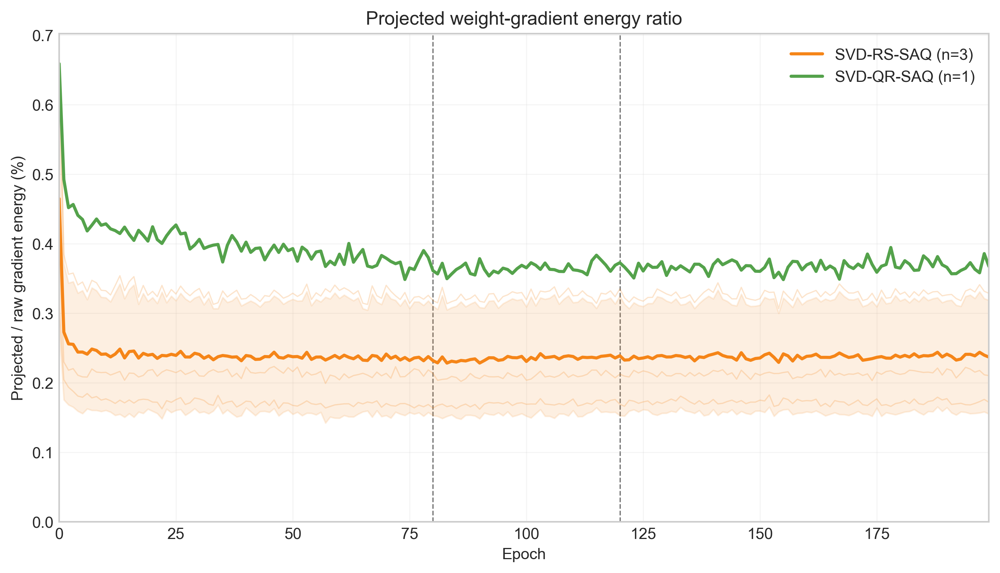

# SVD-QR-SAQ 实验记录

> 任务：CIFAR-100 图像分类
>
> 实验状态：第一轮已完成（SVD-RS-SAQ：seed 1–3；SVD-QR-SAQ：seed 1；均为 200 epoch）
>
> 统计说明：SVD-RS-SAQ 报告 3 个种子的 mean ± sample standard deviation；SVD-QR-SAQ 先只做了 1 个种子，仅报告单次观测值，不计算标准差或显著性。

## 1. 实验目的

本实验是“量化残差子空间引导的 Sharpness-Aware Quantization（SAQ）”路线的验证。

本轮实验使用截断奇异值分解（SVD）提取量化残差的主模式：

$$
D_{l,j}=u_{l,j}v_{l,j}^{\top}.
$$

随后将原 SAQ 的权重扰动限制在这些完整 rank-1 矩阵模式张成的低维空间中。

本轮需要回答的核心问题是：

> 在模式数量和矩阵结构一致的条件下，由真实量化残差 SVD 得到的低维方向，是否比随机 rank-1 矩阵方向更适合作为 SAQ 的权重扰动空间？

- **rank-1 模式** 就是由一个列向量与一个行向量的外积构成的，rank = 1 的矩阵（$D_{l,j}=u_{l,j}v_{l,j}^{\top}$）。SVD 将残差表示为若干这种完整模式的加权和，取前 8 个模式，就是保留能量最大的 8 种残差变化结构。

实验包含两个实验组：

| 组别 | 优化器标识 | 权重扰动空间 | 作用 |
|---|---|---|---|
| SVD-RS-SAQ | `SVD_RS_QSAM_SGD` | 固定随机正交 rank-1 矩阵模式 | 与真实残差方法匹配的随机对照 |
| SVD-QR-SAQ | `SVD_QR_QSAM_SGD` | 初始量化残差的前 $r$ 个 SVD 模式 | 本轮待验证方法 |


## 2. 实验设置

除权重扰动子空间的构造方法外，本实验与上一轮 CIFAR-100 / PreResNet-20 / W4A4 SAQ 实验保持一致。

| 类别 | 设置 |
|---|---|
| 数据集 | CIFAR-100，训练集 50,000 张、测试集 10,000 张、100 类 |
| 网络 | `qsampreresnet20`（PreResNet-20 的 QSAM 版本） |
| 预训练初始化 | `./checkpoints/pretrained/r20_w32a32.pth` |
| 量化实现 | `LIQ_wn_qsam`，学习量化区间 |
| 位宽 | 主干 W4A4；首层和末层遵循 `quantize_first_last=True` 的模型实现 |
| Batch size / worker | 128 / 4 |
| 外层优化器 | Nesterov SGD，momentum=0.9，weight decay=$10^{-4}$ |
| 初始学习率 / clip 学习率 | 0.01 / 0.01 |
| 训练轮数 | 200（epoch 0–199） |
| 学习率调度 | MultiStepLR，epoch 80、120 分别衰减 10 倍 |
| 损失函数 | CrossEntropyLoss，label smoothing=0 |
| SAQ 半径 | $\rho=0.4$；`bit_warmup_epochs=0` |
| 其他 SAQ 开关 | `include_wclip=False`，`include_aclip=True`，`include_bn=True`，eta=0.01 |
| 已完成训练随机种子 | SVD-RS-SAQ：1、2、3；SVD-QR-SAQ：1 |
| 每层最大模式数 | $r=8$ |
| 随机模式种子 | 10001、10002、10003，分别对应训练 seed 1、2、3 |
| SVD/随机模式更新方式 | 第一次 clean forward/backward 后构造，后续固定至训练结束 |
| 训练流程 | 原 SAQ 的两次前反向流程 |

每层实际模式数为：

$$
r_l=\min\left(8,d_{\mathrm{out},l},d_{\mathrm{in},l}^{*}\right),
$$

其中卷积层展平后的输入维度为：

$$
d_{\mathrm{in},l}^{*}=d_{\mathrm{in},l}k_hk_w.
$$

本轮实际完成 4 个完整训练 run：

| 方法 | Seed | Projection seed | Epoch |
|---|---:|---:|---:|
| SVD-RS-SAQ | 1 | 10001 | 200 |
| SVD-RS-SAQ | 2 | 10002 | 200 |
| SVD-RS-SAQ | 3 | 10003 | 200 |
| SVD-QR-SAQ | 1 | 不适用 | 200 |

因此，本轮的主要统计对照是“三种子 SVD-RS-SAQ”与“单种子 SVD-QR-SAQ”。原始 SAQ 的 3 个历史种子用于同配置背景参照，但不是本次重新训练的 run。

## 3. 方法原理与实现流程

### 3.1 量化残差定义

对第 $l$ 个量化卷积层或全连接层，将送入伪量化过程的浮点权重记为 $W_{s,l}$，将反量化后的有效量化权重记为 $W_{q,l}$，量化残差定义为：

$$
R_l=W_{s,l}-W_{q,l}.
$$

因此：

$$
W_{s,l}=W_{q,l}+R_l.
$$

对卷积核按输出通道展平：

$$
\bar R_l
\in
\mathbb R^{d_{\mathrm{out},l}\times
(d_{\mathrm{in},l}k_hk_w)}.
$$

全连接层权重保持二维矩阵形式。

当前实现通过量化层第一次 clean forward 保存的 `quantization_source` 和有效伪量化权重 `x` 计算残差。该残差只用于初始化固定模式，不作为可训练参数，也不直接加入模型权重。

### 3.2 SVD-QR-SAQ：真实量化残差模式

对展平后的量化残差执行 thin SVD：

$$
\bar R_l=U_l\Sigma_lV_l^\top.
$$

取最大的前 $r_l$ 个奇异值对应的左右奇异向量，并定义：

$$
D_{l,j}=u_{l,j}v_{l,j}^\top,
\qquad j=1,\ldots,r_l.
$$

由于 $U_l$ 和 $V_l$ 的列分别正交，这些配对 rank-1 模式在 Frobenius 内积下正交归一：

$$
\langle D_{l,i},D_{l,j}\rangle_F=\delta_{ij},
\qquad
\|D_{l,j}\|_F=1.
$$

原始量化残差的截断 SVD 可以写为：

$$
\bar R_{l,r}
=
\sum_{j=1}^{r_l}\sigma_{l,j}D_{l,j}.
$$

本实验使用奇异值 $\sigma_{l,j}$ 对残差模式排序，并用于计算残差能量捕获率；构造 SAM 扰动时使用单位范数模式 $D_{l,j}$，不再额外乘以奇异值。这样可以避免不同层的奇异值尺度改变实际扰动半径，使 $\rho=0.4$ 与其他 SAQ 实验保持可比。

设第一次 clean backward 得到的有效量化权重梯度为：

$$
G_l=\nabla_{W_{q,l}}\mathcal L.
$$

梯度在每个 SVD 模式上的坐标为：

$$
c_{l,j}
=
\langle G_l,D_{l,j}\rangle_F
=
u_{l,j}^\top G_lv_{l,j}.
$$

投影梯度为：

$$
\widetilde G_l
=
\sum_{j=1}^{r_l}c_{l,j}D_{l,j}.
$$

新的投影梯度同时约束输出方向和展平后的输入/卷积核方向，每层只有 $r_l$ 个完整矩阵模式。

- 这里我理解的 **“同时约束两侧方向”** 是：
$\widetilde G_l = \sum_{j=1}^{r_l}c_{l,j}D_{l,j}$ 中的每一项只能沿完整的
$u_{l,j}v_{l,j}^\top$ 变化，所以输出通道组合 $u_j$ 与输入/卷积核组合 $v_j$
必须成对出现。想到用SVD构造扰动的原理就是 它构成的投影空间的结构完整性。（理论上的优势）

### 3.3 SVD-RS-SAQ：结构匹配的随机对照

为了判断实验收益是否来自量化残差本身，需要构造模式数量、矩阵结构和范数均与 SVD-QR-SAQ 一致的随机对照。

对每层分别生成高斯随机矩阵，并正交化得到：

$$
U_l^{(R)}
\in\mathbb R^{d_{\mathrm{out},l}\times r_l},
\qquad
V_l^{(R)}
\in\mathbb R^{d_{\mathrm{in},l}^{*}\times r_l}.
$$

随机模式定义为：

$$
D_{l,j}^{(R)}
=
u_{l,j}^{(R)}(v_{l,j}^{(R)})^\top.
$$

它们同样满足：

$$
\langle D_{l,i}^{(R)},D_{l,j}^{(R)}\rangle_F
=
\delta_{ij},
\qquad
\|D_{l,j}^{(R)}\|_F=1.
$$

随机对照的梯度投影采用与真实残差方法完全相同的公式：

$$
\widetilde G_l^{(R)}
=
\sum_{j=1}^{r_l}
\langle G_l,D_{l,j}^{(R)}\rangle_F
D_{l,j}^{(R)}.
$$

随机模式在 CPU 上使用 float32 和显式 `projection_seed` 构造，随后移动到对应量化层的设备和数据类型。这样可以避免随机对照依赖 CUDA 随机数实现。

### 3.4 全局扰动归一化

SVD-QR-SAQ 和 SVD-RS-SAQ 均此保留原实验对 activation clip、bias 和 BatchNorm 参数的处理方式。

构造全局梯度范数：

$$
N
=
\sqrt{
\sum_l\|\widetilde G_l\|_F^2
+
\sum_{p\in\mathcal A}\|g_p\|_2^2
}.
$$

其中集合 $\mathcal A$ 包括当前设置下参与 SAM 扰动的 activation clip、量化层 bias 和 BatchNorm 参数。由于 `include_wclip=False`，weight clip 参数不参与扰动。

权重扰动为：

$$
\epsilon_l
=
\rho\frac{\widetilde G_l}{N+10^{-12}}.
$$

其他参与参数使用各自未投影的梯度和相同的全局缩放系数。因此，所有实际扰动合并后的全局 $L_2$ 范数为 $\rho$，而单独的权重扰动范数可以小于 $\rho$。

### 3.5 每个 mini-batch 的训练流程

每个 mini-batch 执行：

1. 使用未扰动的量化模型进行第一次 clean forward。
2. 计算 clean loss 并执行第一次 backward。
3. 第一个 mini-batch 在此时从所有量化层提取初始量化残差，并构造固定 SVD 模式或随机模式。
4. 将每层有效量化权重梯度投影到对应的 rank-1 模式空间。
5. 将投影权重梯度与其他参与扰动的梯度一起做全局范数归一化。
6. 把权重扰动写入量化层的临时 `epsilon`，并临时扰动 activation clip、bias 和 BatchNorm 参数。
7. 切换量化层到 second-forward 状态，在扰动模型上执行第二次 forward/backward。
8. 恢复临时扰动，使用第二次 backward 得到的梯度执行外层 SGD 更新。
9. 清空 `epsilon` 并切回 first-forward 状态，进入下一个 mini-batch。

SVD 或随机模式只在第一次使用时构造一次，后续 200 个 epoch 不重新计算。

- **可以理解为**：第一个 mini-batch 的初始量化残差为每一层提供最多 8 个主要的完整权重变化模式，也就是8个方向；之后training只允许重扰动在这 8 个固定方向的线性组合中移动？
- 目前setting 是rank = 8 （也就是8个方向），固定初始量化残差 （如果要优化是否可以改rank/不固定残差？）

### 3.6 存储与计算方式

实现中不显式保存全部 dense 模式 $D_{l,j}$。每层只保存：

$$
U_{l,r}\in\mathbb R^{m\times r_l},
\qquad
V_{l,r}\in\mathbb R^{n\times r_l}.
$$

投影系数通过：

$$
c_j=u_j^\top Gv_j
$$

计算，投影矩阵通过：

$$
\widetilde G=(U\odot c)V^\top
$$

重建，从而避免保存 $r_l$ 份与完整权重同尺寸的矩阵。

## 4. 诊断指标

### 4.1 初始残差能量捕获率

对每层记录：

$$
E_l(r_l)
=
\frac{
\|\operatorname{Proj}_{\mathcal S_l}(\bar R_l)\|_F^2
}{
\|\bar R_l\|_F^2
}.
$$

对于 SVD-QR-SAQ，该指标等价于：

$$
E_l(r_l)
=
\frac{
\sum_{j=1}^{r_l}\sigma_{l,j}^2
}{
\sum_j\sigma_{l,j}^2
}.
$$

对于 SVD-RS-SAQ，则表示真实量化残差在随机 rank-1 模式空间中的投影能量比例。该指标在模式初始化时逐层写入训练日志。

### 4.2 投影权重梯度能量比

每个 mini-batch 计算：

$$
Q
=
\frac{
\sum_l\|\widetilde G_l\|_F^2
}{
\sum_l\|G_l\|_F^2
}.
$$

该指标衡量真实权重梯度中有多少能量进入 SVD 模式限制下的 SAM 权重扰动。当前实现将每个 epoch 内各 mini-batch 的平均值写入 TensorBoard：

```text
projected_qsam/weight_gradient_energy_ratio
```

### 4.3 精度、损失与稳定性指标

每个 run 记录：

1. 每个 epoch 的训练损失、训练 Top-1/Top-5。
2. 每个 epoch 的测试损失、测试 Top-1/Top-5。
3. 200 epoch 内最佳测试 Top-1 及对应 epoch。
4. 最后一个 epoch 的测试 Top-1。
5. epoch 120–199 的平均测试 Top-1 和平均测试损失。
6. 最佳模型 checkpoint 和逐 epoch checkpoint。

训练完成后，只有拥有 3 个种子的 SVD-RS-SAQ 和历史 SAQ 汇总为 mean ± sample standard deviation。SVD-QR-SAQ seed 1 以单次结果展示，不添加误差带，也不把 epoch 间波动当成跨种子方差。

### 4.4 时间与显存指标

资源指标从每个 `experiment.log` 解析：

1. 总时间取日志首、末时间戳之差，包含模型/数据初始化、200 轮训练和测试、checkpoint 写入等过程。
2. 平均训练/测试 epoch 时间取日志中的 `Total time` 记录。
3. 峰值显存取训练进度日志中的 `max mem` 最大值；代码对应 `torch.cuda.max_memory_allocated() / 2^{20}`，单位为 MiB。

该显存值是 PyTorch 报告的峰值已分配显存，且日志显示为整数；它不包含 CUDA context、驱动、PyTorch reserved-but-unused 显存或 CPU 端初始化 SVD 的临时内存。

## 5. 实验结果

### 5.1 汇总结果

表中 `±` 均为跨种子的 sample standard deviation；单次 SVD-QR-SAQ 不使用 `±`。

| 方法 | n | 最佳测试 Top-1 (%) | 最终测试 Top-1 (%) | epoch 120–199 Top-1 (%) | epoch 120–199 测试 loss | 最佳测试 Top-5 (%) | 最终测试 Top-5 (%) |
|---|---:|---:|---:|---:|---:|---:|---:|
| 原始 SAQ（历史参照） | 3 | 68.063 ± 0.068 | 67.543 ± 0.385 | 67.560 ± 0.036 | 1.2229 ± 0.0006 | 91.020 ± 0.070 | 90.677 ± 0.076 |
| SVD-RS-SAQ | 3 | 67.837 ± 0.228 | 67.433 ± 0.119 | 67.373 ± 0.158 | 1.2548 ± 0.0062 | 91.020 ± 0.044 | 90.740 ± 0.053 |
| SVD-QR-SAQ | 1 | 67.700 | 67.300 | 67.262 | 1.2557 | 91.040 | 90.900 |

与原始 SAQ 三种子均值相比，SVD-RS-SAQ 的最佳、最终和后期平均 Top-1 分别低 0.227、0.110 和 0.187 个百分点，后期测试 loss 高 0.0320。SVD-QR-SAQ seed 1 的对应差值为 -0.363、-0.243 和 -0.297 个百分点，后期测试 loss 高 0.0329。由于 SVD-QR-SAQ 只有一个种子，这些差值只能作为描述性结果，不能据此判断总体均值或显著性。

若只做相同训练 seed 的配对观察，SVD-QR-SAQ seed 1 与 SVD-RS-SAQ seed 1 的最佳 Top-1 都是 67.70%；QR 的最终 Top-1 低 0.17 个百分点，后期平均 Top-1 低 0.049 个百分点，但后期 loss 低 0.0014。总体上二者曲线非常接近，没有出现“真实残差 SVD 模式明显优于结构匹配随机模式”的信号。

### 5.2 各 seed 结果

| 方法 | Seed | 最佳 Top-1（epoch） | 最终 Top-1 | 后期 Top-1 均值 | 后期 epoch 内 SD | 后期测试 loss | 最佳 Top-5（epoch） | 最终 Top-5 |
|---|---:|---:|---:|---:|---:|---:|---:|---:|
| SVD-RS-SAQ | 1 | 67.70（196） | 67.47 | 67.311 | 0.167 | 1.2572 | 90.97（124） | 90.76 |
| SVD-RS-SAQ | 2 | 67.71（185） | 67.30 | 67.255 | 0.174 | 1.2595 | 91.04（141） | 90.78 |
| SVD-RS-SAQ | 3 | 68.10（174） | 67.53 | 67.553 | 0.212 | 1.2479 | 91.05（150） | 90.68 |
| SVD-QR-SAQ | 1 | 67.70（146） | 67.30 | 67.262 | 0.177 | 1.2557 | 91.04（158） | 90.90 |

“后期 epoch 内 SD”只描述同一个 run 在 epoch 120–199 的曲线波动，不是随机种子不确定性。QR seed 1 的后期波动 0.177 与三个 RS run 的 0.167–0.212 范围一致。

### 5.3 曲线与诊断指标

为了直观分析，绘制如下曲线：









可以看出，SVD-QR-SAQ 与 SVD-RS-SAQ 的精度、loss 轨迹大部分重合；SVD 两组的训练精度略高于原始 SAQ，但测试精度略低，导致最终 train–test Top-1 gap 更大：原始 SAQ 为 20.917 ± 0.333 个百分点，SVD-RS-SAQ 为 21.517 ± 0.102，SVD-QR-SAQ seed 1 为 21.668。

**这个结果是不是更符合“QR子空间的受限扰动没有带来更强泛化正则”的表现，or 过拟合？**

Top-5 方面差异很小：三种子 SAQ 与 SVD-RS-SAQ 的最佳 Top-5 均为 91.020%，QR seed 1 为 91.040%。结合 Top-1 下降而测试 loss 上升，可理解为类别仍常出现在前五名，但正确类别的精细排序或置信度没有改善。

**为什么QR-SAQ的测试结果没有表现出理论预期的优势，理论上有优势的压缩方向还不如随机的？**

**会不会是 ""QR 方向理论上更好"" 只对量化残差重建成立，不对 SAM 优化目标成立？**


## 6. 子空间诊断与原理分析（可优化的点）

### 6.1 初始量化残差捕获



| 方法 / seed | 逐层捕获率宏平均 | 按残差范数平方加权的全局捕获率 |
|---|---:|---:|
| SVD-RS-SAQ seed 1 | 0.280% | 0.063% |
| SVD-RS-SAQ seed 2 | 0.267% | 0.073% |
| SVD-RS-SAQ seed 3 | 0.381% | 0.075% |
| SVD-QR-SAQ seed 1 | 61.083% | 36.807% |

QR seed 1 的逐层捕获率从深层 3×3 卷积的约 25.5%–27.8%，到首层 98.9%、部分浅层/下采样层 90% 以上，`fc` 为 84.3%。宏平均高于全局捕获率，是因为残差范数较大的深层卷积恰好具有较低的 rank-8 捕获率。即便如此，QR 的全局捕获仍约为 RS 三种子均值的 524 倍，说明 SVD 代码确实找到了量化残差的主模式，实验并未退化成随机方向。

### 6.2 权重梯度捕获



| 方法 / seed | epoch 0 | 全 200 epoch 均值 | epoch 120–199 均值 | epoch 199 |
|---|---:|---:|---:|---:|
| SVD-RS-SAQ seed 1 | 0.675% | 0.330% | 0.327% | 0.329% |
| SVD-RS-SAQ seed 2 | 0.405% | 0.214% | 0.213% | 0.210% |
| SVD-RS-SAQ seed 3 | 0.314% | 0.172% | 0.172% | 0.172% |
| SVD-QR-SAQ seed 1 | 0.659% | 0.380% | 0.367% | 0.367% |

相同训练 seed 1 下，QR 的全程平均梯度捕获率比 RS 高 0.050 个百分点（相对约 15.3%），后期高 0.040 个百分点（相对约 12.3%）；但 QR 仍只保留约 0.38% 的原始权重梯度能量。也就是说，量化残差高度可由前 8 个 SVD 模式重建，并不意味着训练损失梯度与这些模式高度对齐。

这是本轮最关键的诊断：每层的 8 个配对模式只有 $r_l\leq 8$ 个自由坐标，空间极窄。上一轮左子空间投影 $QQ^\top G$ 在一个 $m\times n$ 权重矩阵上保留的是约 $r_l n$ 维空间，而本轮配对 SVD 模式只保留 $r_l$ 维；因此不能仅按同一个 `rank=8` 把两轮的梯度捕获率直接横向比较。当前设计更严格地测试“完整量化残差模式”，但代价是绝大多数梯度能量被排除。

### 6.3 为什么高残差捕获没有转化为精度收益

综合结果支持以下解释：

**（这里我认同1.3.**

1. **优化目标错位。** SVD 最大化的是初始量化残差重建能量，不是损失梯度能量或局部最坏方向；残差主方向未必是决定 sharpness 的方向。
2. **子空间容量过小。** 每层仅 8 个配对 rank-1 坐标，梯度捕获长期低于 0.4%，可能过度限制了 SAM 权重扰动的方向多样性。
3. **固定基可能陈旧。** 模式只由第一个 mini-batch 的初始量化残差构造一次。随着浮点权重和量化区间更新，后续残差结构可能旋转，但扰动空间不更新。
4. **非权重参数仍参与全局归一化。** activation clip、bias 和 BatchNorm 梯度与投影后的权重梯度共用全局范数；在权重投影能量很低时，实际扰动的组成可能更多由这些未投影参数决定。
5. **观察到的是泛化下降而非训练受阻。** SVD 两组最终训练 Top-1 略高、测试 Top-1 略低，train–test gap 扩大，说明当前受限扰动没有形成优于原始 SAQ 的正则化方向。

## 7. 结论与有效范围

第一轮结果未支持“初始量化残差的前 8 个配对 SVD 模式优于结构匹配随机模式”这一假设。QR seed 1 与 RS seed 1 最佳 Top-1 相同，后期指标非常接近；相对原始 SAQ，SVD-RS-SAQ 三种子均值和 QR 单次结果都没有获得 Top-1 或测试 loss 改善。

同时，诊断证明方法实现达到了预期的残差结构选择：QR 的初始残差捕获远高于随机对照。因此负面结果更可能来自“残差主模式与 sharpness/梯度方向不一致”以及“配对 rank-1 空间过窄”，而不是 SVD 没有提取到残差主成分。

结论的有效范围必须限定为：CIFAR-100、QSAM-PreResNet-20、W4A4、$\rho=0.4$、固定初始模式、每层最多 8 个配对 rank-1 模式，以及目前仅有的 QR seed 1。由于 QR 缺少 seed 2、3，不能对其期望精度、方差或与 RS 的统计显著性下结论。

## 8. 后续建议

#### （AI给的建议，看看是否要顺着这个线来继续优化？

建议按以下优先级继续：

1. **先补 QR seed 2、3。** 这是把当前描述性结果升级为三种子结论的最低成本步骤；配置保持不变，不加入 1F 变体。
2. **再做 rank 扫描。** 优先比较 $r=16,32$，同时记录梯度能量比。若精度随梯度捕获显著上升，可以验证“rank 8 容量过小”的解释。
3. **尝试残差模式与梯度模式混合。** 例如一部分模式来自残差 SVD，另一部分来自初始或滑动平均梯度的 SVD，以直接缓解优化目标错位。
4. **评估周期性更新基。** 可在学习率阶段切换点（epoch 80、120）重新提取一次残差 SVD，并记录更新前后的残差与梯度捕获率，判断固定基是否陈旧。
5. **若关注时间，做受控基准。** 在同一空闲 GPU 上交替运行相同数量的短 epoch，避免把服务器负载差异误判为 QR/RS 的算法开销。


