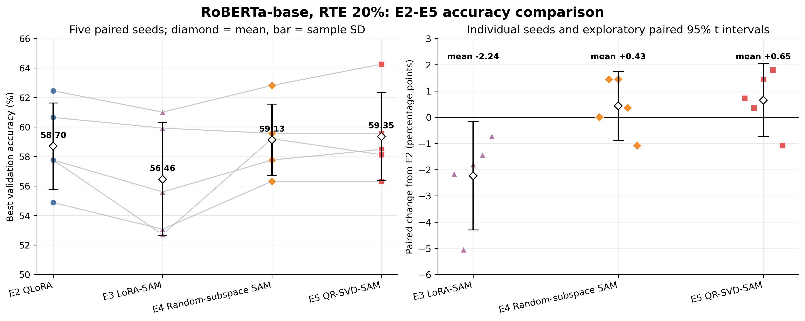
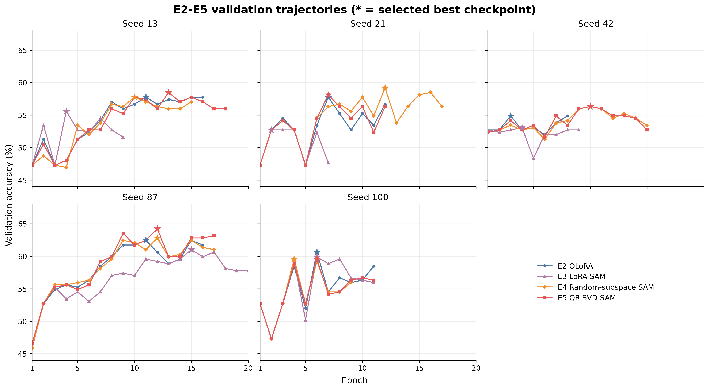
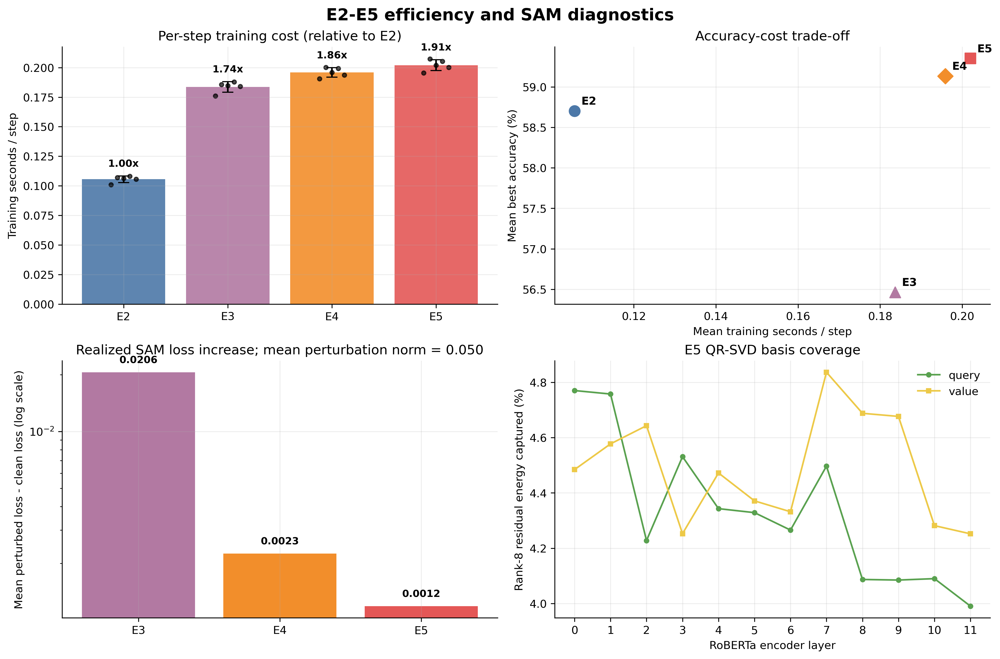

# RoBERTa-base 低资源 RTE：E2–E5 完整实验记录

- 完成日期：2026-09-23
- E2/E5 原始结果：`records/e2_e5_rte20_20260921_032917`
- E3/E4 原始结果：`records/e3_e4_rte20_20260923_032434`

## 1. 实验框架

目标是在相同的冻结 4-bit RoBERTa-base 主干与 LoRA 配置下，比较不同 SAM 扰动空间对低资源 RTE 分类的影响。

| 组别 | 方法 | SAM 扰动空间 | 每步前/反向 |
| --- | --- | --- | ---: |
| E2 | NF4-QLoRA + AdamW | 无 | 1 |
| E3 | NF4-QLoRA + LoRA-SAM | LoRA 的 $A,B$ 参数空间 | 2 |
| E4 | NF4-QLoRA + Random-subspace SAM | 随机低秩权重子空间 | 2 |
| E5 | NF4-QLoRA + QR-SVD-SAM | 量化残差的主导 SVD 子空间 | 2 |

四组的核心配置、数据索引、训练种子及软件版本已核对一致；E3–E5 仅改变 SAM 扰动空间，分类头参与训练但不施加 SAM 扰动。

## 2. 实验配置

| 类别 | 配置 |
| --- | --- |
| 模型 | `FacebookAI/roberta-base@e2da8e2f811d1448a5b465c236feacd80ffbac7b` |
| 数据 | GLUE-RTE；训练集 20%（每种子 497 条），完整验证集 277 条 |
| 种子 | 13、21、42、87、100 |
| 主干 | 4-bit NF4 weight-only，double quantization，冻结 |
| 计算 | FP16；单卡 RTX 2080 Ti |
| LoRA | rank 8，alpha 16，dropout 0.05；12 层 attention 的 `query/value` |
| 优化 | AdamW，学习率 $2\times10^{-4}$，weight decay 0.01，warmup ratio 0.06 |
| 训练 | batch size 16，最多 20 epoch，early-stopping patience 5 |
| SAM | $\rho=0.05$；E4/E5 子空间 rank 8；E4 basis seed 12345 |
| 指标 | 验证集 Accuracy；按最佳 Accuracy 选择 checkpoint |

## 3. 实验原理

- **E2：** 冻结 NF4 主干，只用 AdamW 更新 LoRA 与分类头。
- **E3：** 在全部 LoRA $A,B$ 参数中，由 clean gradient 构造全局归一化 SAM 扰动。
- **E4：** 在 24 个目标层各自的 rank-8 随机正交模式中寻找子空间最坏扰动。
- **E5：** 对固定量化残差 $R_l=W_{0,l}-D(Q_{\mathrm{NF4}}(W_{0,l}))$ 做截断 SVD，再将 clean gradient 投影至 24 个目标层的 192 个 QR-SVD 模态，并在该子空间内寻找最坏扰动。

E3–E5 均先在 clean 点确定扰动，再在扰动点计算实际更新梯度；最终仍只更新 LoRA 与分类头。

## 4. 实验结果

### 4.1 最佳验证集准确率

| Seed | E2 | E3 | E4 | E5 |
| ---: | ---: | ---: | ---: | ---: |
| 13 | 57.76% | 55.60% | 57.76% | 58.48% |
| 21 | 57.76% | 52.71% | 59.21% | 58.12% |
| 42 | 54.87% | 53.07% | 56.32% | 56.32% |
| 87 | 62.45% | 61.01% | 62.82% | 64.26% |
| 100 | 60.65% | 59.93% | 59.57% | 59.57% |
| **均值 ± 样本标准差** | **58.70% ± 2.93%** | **56.46% ± 3.84%** | **59.13% ± 2.43%** | **59.35% ± 2.98%** |



相对 E2 的配对统计如下。95% CI 为仅含 5 个配对样本的探索性 t 区间；“胜/平/负”按相同 seed 的最佳 Accuracy 统计。

| 比较 | 平均差异 | 95% CI | 胜/平/负 |
| --- | ---: | ---: | ---: |
| E3−E2 | −2.24 pp | [−4.30, −0.17] pp | 0 / 0 / 5 |
| E4−E2 | +0.43 pp | [−0.89, +1.76] pp | 3 / 1 / 1 |
| E5−E2 | +0.65 pp | [−0.75, +2.05] pp | 4 / 0 / 1 |
| E5−E4 | +0.22 pp | [−0.95, +1.39] pp | 2 / 2 / 1 |

### 4.2 训练过程与计算代价



| 组别 | 平均最佳/完成 epoch | 时间/step | 相对 E2 | 平均训练时间/次 |
| --- | ---: | ---: | ---: | ---: |
| E2 | 7.6 / 12.6 | 0.1056 ± 0.0028 s | 1.00× | 42.50 ± 11.34 s |
| E3 | 6.2 / 11.2 | 0.1837 ± 0.0045 s | 1.74× | 66.11 ± 31.38 s |
| E4 | 9.6 / 14.6 | 0.1959 ± 0.0039 s | 1.86× | 91.71 ± 21.62 s |
| E5 | 9.6 / 14.6 | 0.2020 ± 0.0046 s | 1.91× | 94.24 ± 18.90 s |

总训练时间受早停 epoch 影响，跨方法效率以“时间/step”为主。E3–E5 的两步 SAM 代价均接近 E2 的两倍。

### 4.3 扰动与子空间诊断



| 组别 | 扰动坐标数 | 平均扰动范数 | 平均 perturbed−clean loss |
| --- | ---: | ---: | ---: |
| E3 | 294,912 | 0.050 | 0.02060 |
| E4 | 192 | 0.050 | 0.00225 |
| E5 | 192 | 0.050 | 0.00119 |

上述 loss 差值为日志记录训练步的均值。E5 的 rank-8 basis 对各目标矩阵量化残差能量的覆盖率平均为 4.41%，范围为 3.99%–4.84%。

绘图脚本：[`plot_e2_e5_results.py`](../analysis/plot_e2_e5_results.py)。在项目根目录运行：

```bash
python analysis/plot_e2_e5_results.py \
  --e2-e5-run-dir records/e2_e5_rte20_20260921_032917 \
  --e3-e4-run-dir records/e3_e4_rte20_20260923_032434
```

## 5. 实验分析

1. **E4/E5 有小幅正向信号，但尚不稳定。** E4、E5 分别比 E2 高 0.43、0.65 pp，但两个配对区间均包含 0。RTE 验证集仅 277 条，1 个样本约等于 0.36 pp，因此当前增益只有约 1–2 个样本的量级。

2. **当前无法证明量化残差方向优于随机方向。** E5 只比同维、同流程的 E4 高 0.22 pp，且结果为 2 胜、2 平、1 负，配对区间包含 0。E4 目前只使用一个 basis seed，后续应增加随机 basis 重复实验。

3. **E3 在当前设置下明显偏弱，但不能直接归因于 LoRA-SAM 无效。** E3 在 5 个种子上均低于 E2；同时其平均增损是 E4 的约 9.1 倍、E5 的约 17.4 倍。原因是 E3 在 294,912 维 LoRA 因子空间中归一化，而 E4/E5 在 192 维正交权重模态中归一化；相同 $\rho$ 并不代表几何上等强的扰动。应分别搜索各扰动空间的 $\rho$。

4. **E4/E5 的收敛轨迹接近，E5 没有形成一致领先。** 两组平均最佳 epoch 和完成 epoch 完全相同；逐种子曲线显示二者优势随 seed 改变。这与 E5−E4 的小配对差异一致。

5. **QR-SVD 只使用了很窄的残差子空间。** rank 8 平均覆盖 4.41% 的残差能量，适合验证“主导方向”假设，但不足以判断更高 rank 是否更有效，需补充 rank 消融。

## 6. 总结结论

- E5 取得最高均值 **59.35%**，相对 E2 为 **+0.65 pp**；E4 次之，为 **+0.43 pp**。两者均表现出正向趋势，但证据不足以确认稳定提升。
- E5 相对 E4 仅 **+0.22 pp**，本轮尚未证明“真实量化残差方向”优于同维随机子空间。
- E3 在当前 $\rho=0.05$ 下为 **−2.24 pp**，更可能说明跨空间直接共用 $\rho$ 不公平，而非足以否定 LoRA-SAM。
- E3–E5 每 step 成本为 E2 的 **1.74–1.91 倍**，符合两步 SAM 的预期。
- 下一步优先级：分别调节 E3/E4/E5 的 $\rho$；增加 E4 basis seed；对 E5 做 rank 消融；再扩展到更多任务与数据比例。
