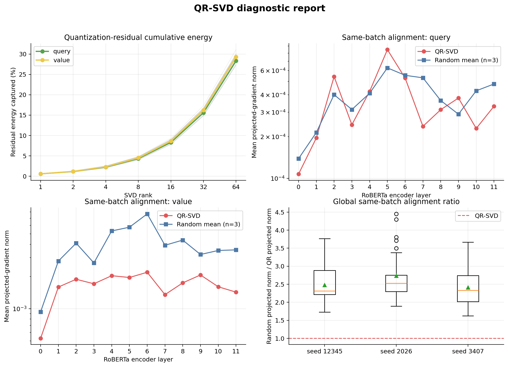

# Stage 1：补齐诊断与调参基础

## 1. 实验目的与配置

本阶段只验证扰动实现、残差谱和 QR/Random 梯度对齐，不计入正式方法比较。

| 项目 | 配置 |
| --- | --- |
| 输出 | `records/stage1_diag_rte20_seed42_20260927_121223/` |
| 模型/任务 | 4-bit NF4 RoBERTa-base；RTE 20% |
| 方法 | E4 Random-subspace SAM；E5 QR-SVD-SAM |
| Train/Data seed | 42 / 42 |
| LoRA / 子空间 rank | 8 / 8 |
| SAM | `rho=0.05`；两步训练 |
| E4 basis seed | 12345 |
| E5 同批次随机对照 | 12345、2026、3407 |
| 诊断间隔 | 10 steps |

## 2. 训练结果

| 组别 | Best/Stop epoch | Best Accuracy | 时间/step | 投影梯度范数 | `perturbed−clean loss` |
| --- | ---: | ---: | ---: | ---: | ---: |
| E4 | 11 / 16 | 56.32% | 0.1959 s | 0.036845 ± 0.036946 | 0.001856 |
| E5 | 3 / 8 | 55.60% | 0.1963 s | 0.006462 ± 0.007278 | 0.000325 |

两组平均扰动范数均为 0.050；逐层扰动能量占比之和的最大误差不超过 `4.44e−16`，未发现 NaN/Inf。E5 有 92% 的记录步产生正增损，E4 为 100%。

单 seed Accuracy 仅用于确认训练链路，不作为 E4/E5 优劣结论。

## 3. 残差谱与同批次对齐

| Rank | 1 | 2 | 4 | 8 | 16 | 32 | 64 |
| ---: | ---: | ---: | ---: | ---: | ---: | ---: | ---: |
| 平均残差能量覆盖 | 0.58% | 1.15% | 2.27% | 4.41% | 8.47% | 15.90% | 28.82% |

rank 8 的逐层覆盖范围为 3.99%–4.84%，奇异值能量没有明显集中在极少数方向。

在 E5 的同一 clean batch、同一训练轨迹上，三个随机子空间均比 QR-SVD 捕获更大的投影梯度：

| Random basis seed | 平均投影范数 | Random/QR 范数比 | Random > QR 的记录步 |
| ---: | ---: | ---: | ---: |
| 12345 | 0.015110 | 2.48× | 25 / 25 |
| 2026 | 0.016173 | 2.73× | 25 / 25 |
| 3407 | 0.017992 | 2.41× | 25 / 25 |

逐层能量同样高度集中于 `value`：E4 为 98.55%，E5 为 93.77%；`query` 分别仅占 1.45% 和 6.23%。

## 4. 分析与结论

1. **诊断实现正确。** 全局半径、逐层贡献和数值稳定性均符合设计。
2. **当前 rank-8 QR 子空间过窄。** 它只覆盖 4.41% 残差能量，不能充分代表 NF4 量化残差。
3. **QR 方向与当前任务梯度的对齐弱于随机方向。** 三个随机对照在全部记录步上均获得更大投影，说明第一次正式实验中 E5≈E4 不是偶然缺少解释，而是当前子空间确实没有展现方向优势。
4. **相同 `rho` 不等于相同有效强度。** E5 的平均增损仅为 E4 的约 17.5%，因此只做等半径比较不足以寻找各方法的最佳性能。
5. **复现性需要控制。** 本地另有相同配置批次 `20260924_043329`，除输出目录外配置、环境和数据记录一致，但最佳 Accuracy 不同；当前 `runtime.deterministic=false`。

## 5. 下一步调参建议

1. 先验证 `deterministic=true` 下重复运行能否复现；后续所有调参批次统一确定性设置。
2. 保留 E4/E5 等半径搜索 `rho ∈ {0.025,0.05,0.10}`，用于检验方向价值。
3. 另做有效强度校准：按约 2.5× 的投影范数差设置候选配对，如 E4 `0.025` 对 E5 `0.0625`、E4 `0.05` 对 E5 `0.125`。
4. `rho` 初筛后执行 `rank ∈ {4,8,16,32}` 的 E4/E5 配对消融；若 rank 32 仍持续改善，再测试 64。
5. 使用多个辅助训练种子和至少三个 random basis seed；最终参数固定前不使用官方 validation 反复选参。

阶段一结论：可以进入调参，但当前证据不支持“rank-8 QR 方向优于随机方向”；后续必须同时解决扰动强度、rank 和复现性问题。
