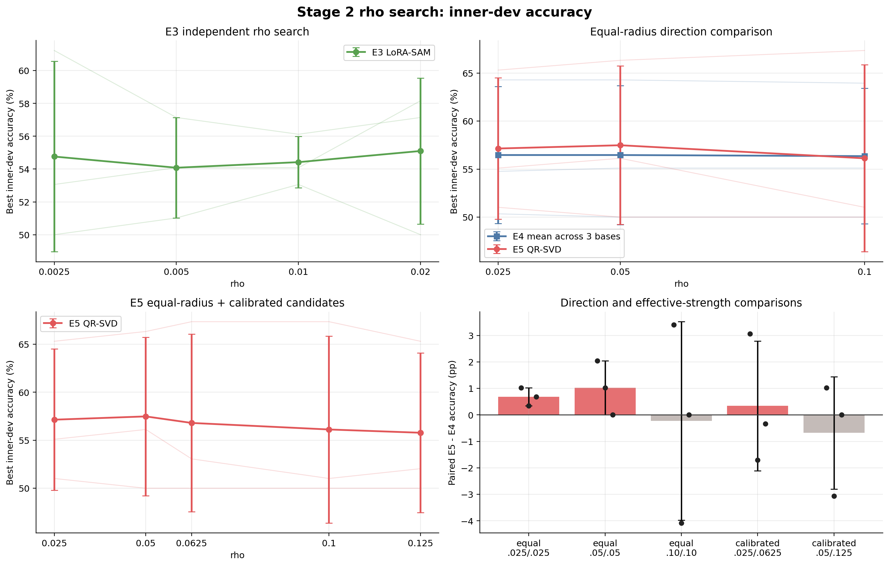
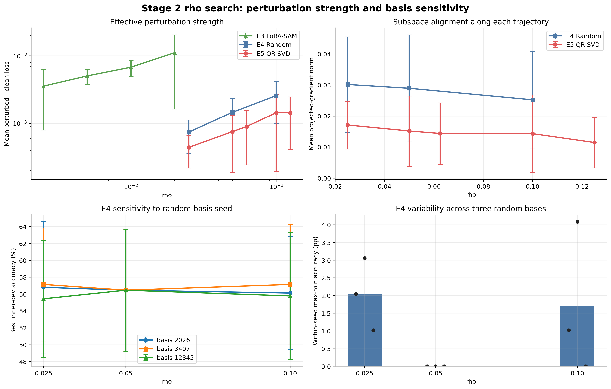

# Stage 2：确定性复现与 rho 搜索

## 1. 实验目的与配置

本阶段先验证确定性训练，再通过 inner-dev 搜索扰动半径；不使用官方 validation 选参。

| 项目 | 配置 |
| --- | --- |
| 输出 | `records/stage2_rho_rte20_20260928_071417/` |
| 模型/任务 | 4-bit NF4 RoBERTa-base；RTE 20% |
| 数据划分 | 每个 data seed 选 497 条，再分为 399 条 inner-train / 98 条 inner-dev |
| 辅助 Train/Data seeds | 17、29、43（配对使用） |
| Inner-dev seed | 314159 |
| 确定性 | `deterministic=true`；`CUBLAS_WORKSPACE_CONFIG=:4096:8` |
| E3 rho | 0.0025、0.005、0.01、0.02 |
| E4/E5 等半径 | 0.025、0.05、0.10 |
| E5 强度校准候选 | 0.0625、0.125 |
| 子空间 rank | 固定为 8 |
| E4 basis seeds | 12345、2026、3407 |
| 训练 | AdamW；最多 20 epoch；patience 5；其余配置沿用 Stage 1 |

正式 sweep 共 54 次：E3 12 次、E4 27 次、E5 15 次；另有 E4/E5 各两次 3-epoch 确定性检查。

## 2. 完整性与复现性

E4、E5 的两次重复运行均通过全部检查：去除 wall-clock 字段后的 `summary.json`、`metrics.jsonl` 完全一致，best/last adapter 的 SHA-256 也完全一致。

| 检查项 | 结果 |
| --- | --- |
| 完成的正式运行 | 54 / 54 |
| 全部运行 deterministic | 是 |
| 官方 validation 用于选参 | 否 |
| 最大扰动半径误差 | `8.97e-9` |
| NaN/Inf | 0 |
| 正增损记录占比 | 97.96% |
| 平均时间/step | E3 0.2359 s；E4 0.2544 s；E5 0.2593 s |

因此 Stage 1 观察到的重复运行差异已被消除，后续调参应继续保持该确定性设置。

## 3. rho 搜索结果

以下 Accuracy 均为 inner-dev 最佳 Accuracy，不能与 Stage 1 的官方 validation Accuracy 直接比较。每个 inner-dev 含 98 条数据，1 个样本约对应 1.02 pp。

### 3.1 E3 独立搜索

| rho | Accuracy（均值 ± 样本标准差） | 平均 `perturbed−clean loss` |
| ---: | ---: | ---: |
| 0.0025 | 54.76% ± 5.80% | 0.003570 |
| 0.005 | 54.08% ± 3.06% | 0.005055 |
| **0.01** | **54.42% ± 1.56%** | **0.006794** |
| 0.02 | 55.10% ± 4.45% | 0.011122 |

`rho=0.02` 的均值最高，但只比 0.01 高 0.68 pp，小于一个 inner-dev 样本，同时方差和增损明显更大。综合均值、稳定性和扰动强度，推荐 E3 使用 `rho=0.01`；0.02 仅作为次选。

### 3.2 E4/E5 等半径比较

E4 先在同一训练 seed 内对三个 random basis 取均值，再跨三个训练 seed 统计。

| rho | E4 Accuracy | E5 Accuracy | 配对 E5−E4 |
| ---: | ---: | ---: | ---: |
| 0.025 | 56.46% ± 7.13% | 57.14% ± 7.36% | +0.68 ± 0.34 pp |
| **0.05** | **56.46% ± 7.24%** | **57.48% ± 8.25%** | **+1.02 ± 1.02 pp** |
| 0.10 | 56.35% ± 7.06% | 56.12% ± 9.73% | −0.23 ± 3.75 pp |

`rho=0.05` 给出最高 E5 均值，三个配对差异为 `+2.04、+1.02、0.00 pp`，未出现负值；`rho=0.10` 的方向优势消失且 seed 波动显著增大。



### 3.3 有效强度校准

| E4 rho / E5 rho | E4/E5 平均增损 | 配对 E5−E4 |
| --- | ---: | ---: |
| 0.025 / 0.0625 | 0.000741 / 0.000898 | +0.34 ± 2.45 pp |
| 0.05 / 0.125 | 0.001465 / 0.001445 | −0.68 ± 2.12 pp |

按约 2.5× 放大 E5 半径后，两组的平均 loss 增量已大致匹配，但 Accuracy 没有改善：配对差异跨 seed 改变方向，第二组均值为负。因此，相同 `rho` 下 E5 增损较弱不是当前性能差异的唯一原因，不保留 `0.0625/0.125` 进入下一阶段。

### 3.4 投影强度与 random basis 敏感性

| rho | E4 投影梯度范数 | E5 投影梯度范数 | E4/E5 比值 | E4 basis 内最大 Accuracy 极差 |
| ---: | ---: | ---: | ---: | ---: |
| 0.025 | 0.03017 | 0.01709 | 1.77× | 2.04 ± 1.02 pp |
| 0.05 | 0.02896 | 0.01517 | 1.91× | 0.00 ± 0.00 pp |
| 0.10 | 0.02524 | 0.01430 | 1.77× | 1.70 ± 2.12 pp |

E5 沿各自训练轨迹的投影梯度仍弱于 E4；但 `rho=0.05` 时三个 random basis 在每个训练 seed 上得到相同最佳 Accuracy，basis 敏感性最低。



## 4. 分析与结论

1. **确定性问题已解决。** E4/E5 的指标和 adapter 均可完全复现，后续实验可把方法差异与运行级随机性分开。
2. **E3 推荐 `rho=0.01`。** 0.02 的小幅均值优势不足一个 inner-dev 样本，且方差和增损更大。
3. **E4/E5 推荐等半径 `rho=0.05`。** 该点同时具有最高 E5 均值、最大的正向平均配对差异，以及最低的 E4 basis 敏感性。
4. **简单放大 E5 半径无效。** 强度校准基本匹配了 loss 增量，却没有形成稳定 Accuracy 收益，说明下一步应改变子空间容量而不是继续放大 `rho`。
5. **证据仍是筛选级别。** 只有 3 个辅助 seed，inner-dev 仅 98 条；`+1.02 pp` 约等于 1 个样本，不能作为 QR 方向有效的最终结论。

## 5. 下一步建议

进入 Stage 3 rank 消融，并继续使用 deterministic + inner-dev：

```text
E4/E5 rho = 0.05
rank ∈ {4, 8, 16, 32}
Train/Data seeds = {17, 29, 43}
E4 basis seeds = {12345, 2026, 3407}
```

主要观察 E5−E4、残差能量覆盖率、投影梯度范数、增损和计算成本。若 rank 32 相对 16 仍持续改善，再补测 64；若 rank 增大后 E5 仍不优于随机方向，则当前“量化残差主导方向”假设缺少支持，不应直接扩展到更大模型。

绘图脚本：`analysis/plot_stage2_rho_search.py`。复现命令：

```bash
python analysis/plot_stage2_rho_search.py \
  --run-dir records/stage2_rho_rte20_20260928_071417 \
  --output-dir reports/param_tuning/figures
```
