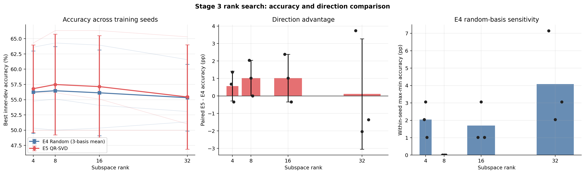
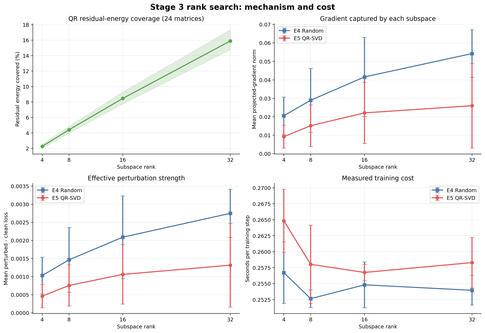

# Stage 3：子空间 rank 搜索

## 1. 实验目的与配置

本阶段固定 Stage 2 选出的 E4/E5 `rho=0.05`，仅改变子空间 rank，检验扩大 QR-SVD 子空间能否提高方向价值。全程使用 inner-dev 选参，不使用官方 validation。

| 项目 | 配置 |
| --- | --- |
| 输出 | `records/stage3_rank_rte20_20260928_145523/` |
| 模型/任务 | 4-bit NF4 RoBERTa-base；RTE 20% |
| 数据划分 | 每个 data seed 选 497 条，再分为 399 条 inner-train / 98 条 inner-dev |
| 方法 | E4 Random-subspace SAM；E5 QR-SVD-SAM |
| rho | 0.05 |
| rank | 4、8、16、32 |
| Train/Data seeds | 17、29、43（配对使用） |
| E4 basis seeds | 12345、2026、3407 |
| 确定性 | `deterministic=true`；`CUBLAS_WORKSPACE_CONFIG=:4096:8` |
| 训练 | AdamW；最多 20 epoch；patience 5；其余配置沿用 Stage 2 |

正式实验共 48 次：E4 36 次、E5 12 次。E4 在每个 rank/train seed 内先对三个 random basis 取均值，再与 E5 按训练 seed 配对。

## 2. 统计与判定规则

1. 同一 rank、同一训练 seed 下，先对 E4 的三个 random basis 取均值，避免将 basis 重复误作独立训练 seed。
2. E5 与上述 E4 均值按训练 seed 配对，统计 Accuracy、E5−E4、投影梯度、`perturbed−clean loss`、残差能量覆盖率和时间/step。
3. 若 E5−E4 随 rank 增大而稳定改善，则选择最小有效 rank；仅当 rank 32 相对 16 仍持续改善时补测 64。
4. 若能量覆盖率上升但 E5−E4 不改善，则不再扩大 rank。Stage 3 仅用于筛选，官方 validation 留待参数完全固定后的正式实验。

运行入口为 `scripts/run_stage3_rank_search.sh`；汇总脚本会检查 48 次运行、固定 `rho=0.05`、rank/seed/basis 矩阵、确定性设置和 inner-dev 隔离，任一条件不满足即拒绝生成汇总。

## 3. 完整性检查

| 检查项 | 结果 |
| --- | --- |
| 完成的正式运行 | 48 / 48 |
| 全部运行 deterministic | 是 |
| 官方 validation 用于选参 | 否 |
| 最大扰动半径误差 | `5.40e-9` |
| NaN/Inf | 0 |
| 正增损记录占比 | 98.43% |

## 4. rank 搜索结果

每个 inner-dev 含 98 条数据，1 个样本约对应 1.02 pp。表中标准差均按 3 个训练 seed 计算。

### 4.1 Accuracy 与配对方向价值

| Rank | E4 Accuracy | E5 Accuracy | 配对 E5−E4 |
| ---: | ---: | ---: | ---: |
| 4 | 56.24% ± 6.75% | 56.80% ± 7.17% | +0.57 ± 0.86 pp |
| **8** | **56.46% ± 7.24%** | **57.48% ± 8.25%** | **+1.02 ± 1.02 pp** |
| 16 | 56.12% ± 7.03% | 57.14% ± 8.35% | +1.02 ± 1.36 pp |
| 32 | 55.33% ± 5.47% | 55.44% ± 8.56% | +0.11 ± 3.16 pp |

rank 8 与 16 的平均配对优势相同，但 rank 8 的 E5 均值略高、配对方差更小。rank 32 的三个配对差异为 `+3.74、−2.04、−1.36 pp`，方向优势在两个 seed 上转负，不能视为持续改善。



### 4.2 残差能量、梯度对齐与扰动强度

| Rank | QR 残差能量覆盖率 | E4/E5 投影梯度范数 | E4/E5 增损 | E4/E5 时间/step |
| ---: | ---: | ---: | ---: | ---: |
| 4 | 2.27% | 0.02057 / 0.00922 | 0.001030 / 0.000461 | 0.2567 / 0.2648 s |
| 8 | 4.41% | 0.02896 / 0.01517 | 0.001465 / 0.000756 | 0.2526 / 0.2580 s |
| 16 | 8.47% | 0.04156 / 0.02211 | 0.002089 / 0.001061 | 0.2548 / 0.2568 s |
| 32 | 15.90% | 0.05422 / 0.02599 | 0.002748 / 0.001316 | 0.2540 / 0.2583 s |

覆盖率随 rank 近似翻倍，E5 投影梯度和增损也随之上升，但没有转化为更高 Accuracy。所有 rank 下，E4 投影梯度仍为 E5 的 `1.88–2.23×`，增损约为 `1.94–2.23×`；QR 子空间与当前任务梯度的对齐弱于随机子空间这一现象未被扩大 rank 消除。时间/step 没有随 rank 单调增加，当前范围内 rank 计算差异被训练波动覆盖。



### 4.3 random basis 敏感性

| Rank | E4 basis 内最大 Accuracy 极差 |
| ---: | ---: |
| 4 | 2.04 ± 1.02 pp |
| **8** | **0.00 ± 0.00 pp** |
| 16 | 1.70 ± 1.18 pp |
| 32 | 4.08 ± 2.70 pp |

rank 8 在三个训练 seed 上均未表现出 basis 选择差异；rank 32 的随机方向敏感性反而最大，进一步说明增大子空间没有提升稳定性。

## 5. 结论与建议

1. **固定 `rank=8`。** 它与 rank 16 具有相同的平均 E5−E4，E5 均值最高，配对波动更小，且 random-basis 敏感性最低；rank 16 没有提供可见收益。
2. **不补测 rank 64。** rank 32 已覆盖 15.90% 残差能量，却没有相对 rank 16 持续改善，且 2/3 个 seed 的 E5−E4 为负；继续增大 rank 缺少依据。
3. **扩大子空间不能解决方向对齐问题。** 能量覆盖、投影梯度和增损均随 rank 增加，但 Accuracy 不升，说明“更多量化残差能量”不等于“更适合当前任务的扰动方向”。
4. **当前证据仍是筛选级别。** 只有 3 个辅助 seed，且 `+1.02 pp` 约等于 1 个 inner-dev 样本，不能据此确认 QR 方向优于随机方向。
5. **下一步进入能量加权消融。** 固定 E4/E5 `rho=0.05、rank=8`，测试奇异值权重指数 `p ∈ {0, 1/2, 1}`；随机对照复用相同奇异值谱，仅替换方向，以分离权重与方向的贡献。

绘图脚本：`analysis/plot_stage3_rank_search.py`。复现命令：

```bash
python analysis/plot_stage3_rank_search.py \
  --run-dir records/stage3_rank_rte20_20260928_145523 \
  --output-dir reports/param_tuning/figures
```
