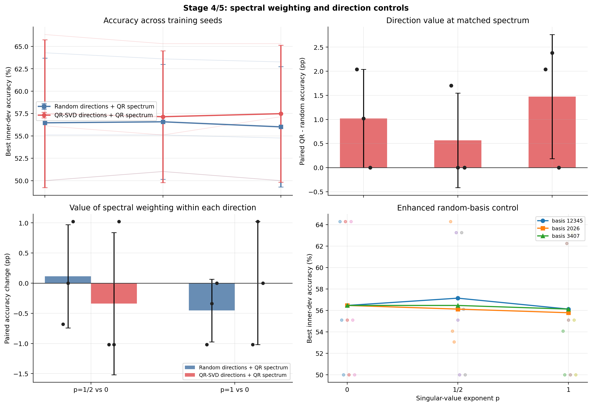
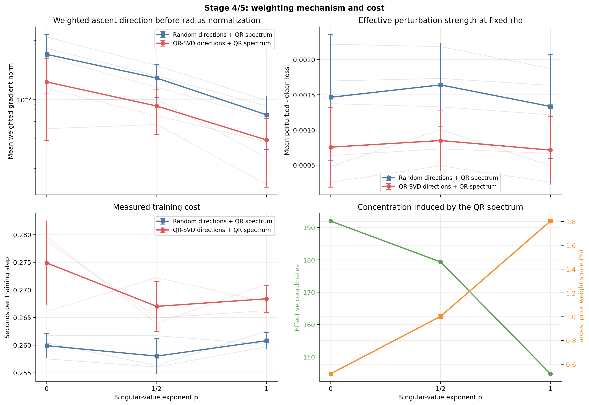

# Stage 4–5：量化残差能量加权与增强随机对照

## 1. 实验目的与固定配置

Stage 3 已选定 `rho=0.05、rank=8`。本阶段联合检验奇异值能量权重与 QR 方向本身的贡献，并继续使用 inner-dev，禁止使用官方 validation 选参。

| 项目 | 配置 |
| --- | --- |
| 输出 | `records/stage45_weighting_rte20_20261008_035610/` |
| 模型/任务 | 4-bit NF4 RoBERTa-base；RTE 20% |
| 数据划分 | 399 条 inner-train / 98 条 inner-dev |
| rho / rank | 0.05 / 8 |
| 权重指数 | `p ∈ {0, 1/2, 1}`；`p=0` 为 Stage 3 实现 |
| Train/Data seeds | 17、29、43（配对使用） |
| Random basis seeds | 12345、2026、3407 |
| 确定性 | `deterministic=true`；`CUBLAS_WORKSPACE_CONFIG=:4096:8` |
| 训练 | AdamW；最多 20 epoch；patience 5；其余配置与 Stage 3 相同 |

## 2. 加权与对照定义

对每层的单位 Frobenius 正交模式 `u_j v_j^T`，先计算任务梯度投影 `g_j`，再构造

```math
d_{l,j}=g_{l,j}\sigma_{l,j}^{p},\qquad
\delta W_l=\rho\frac{\sum_j d_{l,j}u_{l,j}v_{l,j}^{\top}}
{\sqrt{\sum_{l,j}d_{l,j}^{2}}}.
```

这与 `δW_l=Σ_j α_{l,j}σ_{l,j}^p u_{l,j}v_{l,j}^T` 等价，同时保证所有 `p` 的全局实际扰动范数均为 `rho`，避免把权重效果与半径变化混淆。

- **E5 QR-SVD：** 使用量化残差的 QR/SVD 方向及其对应奇异值。
- **随机谱对照：** 逐层复制 E5 完全相同的 8 个奇异值，只将左右方向替换为由 basis seed 决定的随机正交方向。
- 汇总程序会逐值验证 36 次运行使用相同奇异值谱；任何不一致、非确定性运行或官方 validation 泄漏都会中止汇总。

## 3. 实验矩阵与统计规则

共 36 次：E5 为 `3 p × 3 train seeds = 9` 次；随机谱对照为 `3 p × 3 train seeds × 3 basis seeds = 27` 次。

1. 同一 `p`、同一训练 seed 下，先对三个随机 basis 的指标取均值，再计算配对的 `E5−随机均值`。
2. 在每种方向内，按训练 seed 配对计算 `p=1/2−p=0` 与 `p=1−p=0`，分离能量加权收益。
3. 联合分析 Accuracy、配对差异、basis 分布、投影/加权梯度、`perturbed−clean loss`、扰动范数和时间/step。
4. 只有当加权在多数 seed 上同向改善且不依赖个别随机 basis 时，才保留相应 `p` 进入正式五种子实验。

## 4. 完整性与复现性

| 检查项 | 结果 |
| --- | --- |
| 完成的正式运行 | 36 / 36 |
| 全部运行 deterministic | 是 |
| 官方 validation 用于选参 | 否 |
| 随机/QR 谱逐值核对 | 24 层 × 8 值 × 36 次，最大误差 0 |
| 最大扰动半径误差 | `6.30e-9` |
| NaN/Inf | 0 |
| `p=0` 对 Stage 3 rank-8 | 12/12 次核心训练指标完全一致 |

因此，本批数据满足方向与能量权重的配对比较条件；`p=0` 的完全复现也说明新增实现没有改变原始算法。

## 5. 实验结果

每个 inner-dev 含 98 条数据，1 个样本约对应 1.02 pp。E4 先在每个训练 seed 内对三个随机 basis 取均值，表中标准差再按三个训练 seed 计算。

### 5.1 Accuracy 与方向价值

| `p` | 随机谱对照 Accuracy | E5 Accuracy | 配对 E5−随机 |
| ---: | ---: | ---: | ---: |
| **0** | 56.46% ± 7.24% | **57.48% ± 8.25%** | +1.02 ± 1.02 pp |
| 1/2 | **56.58% ± 6.42%** | 57.14% ± 7.36% | +0.57 ± 0.98 pp |
| 1 | 56.01% ± 6.72% | **57.48% ± 7.66%** | **+1.47 ± 1.29 pp** |

`p=1` 的方向差异为 `+2.04、+2.38、0.00 pp`，三个 seed 均非负；但 E5 本身相对 `p=0` 没有平均提升。更大的 E5−随机差距主要来自随机对照下降，而不是 QR 方法绝对 Accuracy 上升。



### 5.2 能量加权相对 `p=0` 的贡献

| 方向 | `p=1/2 − p=0` | `p=1 − p=0` |
| --- | ---: | ---: |
| 随机方向 | +0.11 ± 0.86 pp | −0.45 ± 0.52 pp |
| QR-SVD 方向 | −0.34 ± 1.18 pp | 0.00 ± 1.02 pp |

- `p=1/2` 对 E5 的三个配对变化为 `−1.02、−1.02、+1.02 pp`，不满足多数 seed 同向改善。
- `p=1` 对 E5 为 `−1.02、+1.02、0.00 pp`，均值为零；它改变了 seed 间分布，但没有净收益。
- 所有变化均不超过约一个 inner-dev 样本，当前没有证据表明奇异值加权能提高 E5 的绝对性能。

### 5.3 增强随机对照

| `p` | basis 12345 | basis 2026 | basis 3407 | seed 内最大极差 |
| ---: | ---: | ---: | ---: | ---: |
| 0 | 56.46% | 56.46% | 56.46% | 0.00 ± 0.00 pp |
| 1/2 | 57.14% | 56.12% | 56.46% | 2.04 ± 1.02 pp |
| 1 | 56.12% | 55.78% | 56.12% | 1.02 ± 1.02 pp |

`p=0` 再次对三个 basis 不敏感；加权后 basis 差异出现，但没有某个随机 basis 在所有 `p` 上持续占优。这验证了用多个随机实例及其均值进行比较的必要性，也排除了 E5 结论由单个弱随机基造成的可能。

### 5.4 加权机制与计算成本

| `p` | 有效权重坐标 / 最大权重能量占比 | 随机/E5 加权梯度范数 | 随机/E5 增损 | 随机/E5 时间/step |
| ---: | ---: | ---: | ---: | ---: |
| 0 | 192.00 / 0.52% | 0.02896 / 0.01517 | 0.001465 / 0.000756 | 0.2599 / 0.2749 s |
| 1/2 | 179.36 / 1.00% | 0.01663 / 0.00863 | 0.001640 / 0.000850 | 0.2580 / 0.2670 s |
| 1 | 144.79 / 1.80% | 0.00702 / 0.00389 | 0.001334 / 0.000714 | 0.2608 / 0.2684 s |

随 `p` 增大，权重确实向较大奇异值模式集中；但在固定实际 `rho=0.05` 后，E5 的增损始终约为随机方向的一半，且 Accuracy 没有同步上升。说明简单的 `σ^p` 重加权不能弥补 QR 方向与当前任务梯度对齐较弱的问题。不同 `p` 的时间/step 差异很小，未引入明显训练成本。



## 6. 结论与下一步

1. **能量加权没有带来 E5 绝对收益。** `p=1/2` 略降，`p=1` 与 `p=0` 持平，因此保留最简单且已稳定复现的 `p=0` 作为主配置。
2. **`p=1` 仅提供方向交互信号。** 它把 E5−随机均值扩大至 `+1.47 pp` 且三个 seed 均非负，但提升来自随机方向退化；不能据此宣称加权改善了 QR-SVD。
3. **增强随机对照完成。** 三个 basis 均已纳入均值和分布，未发现由单个随机实例主导结论；后续正式比较继续保留相同的三个 basis seeds。
4. **原假设仍缺少强证据。** QR 在所有 `p` 下的增损约为随机的一半，说明量化残差高能方向并不自然等同于任务有效扰动方向。
5. **进入正式五种子确认。** 主配置固定 E4/E5 `rho=0.05、rank=8、p=0`；重新运行 E2、E3 (`rho=0.01`)、E4 和 E5，重点报告 E5−E4、E5−E2、E5−E3。若资源允许，可把 `p=1` 作为 E4/E5 的次要验证分支，而不作为主设置。

绘图脚本：`analysis/plot_stage45_spectral_weighting.py`。复现命令：

```bash
python analysis/plot_stage45_spectral_weighting.py \
  --run-dir records/stage45_weighting_rte20_20261008_035610 \
  --output-dir reports/param_tuning/figures
```
