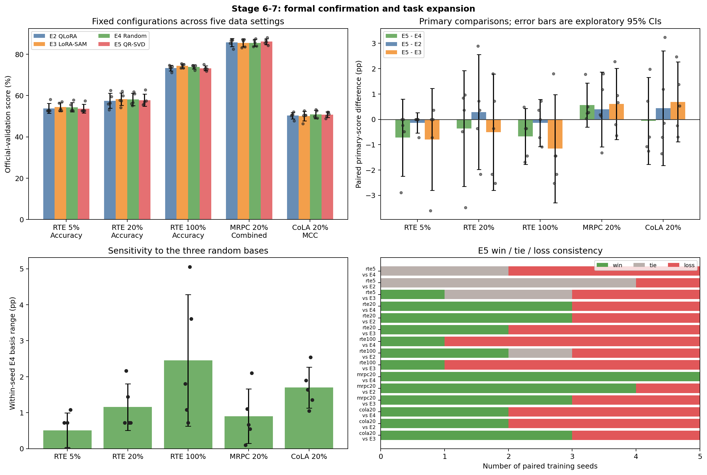
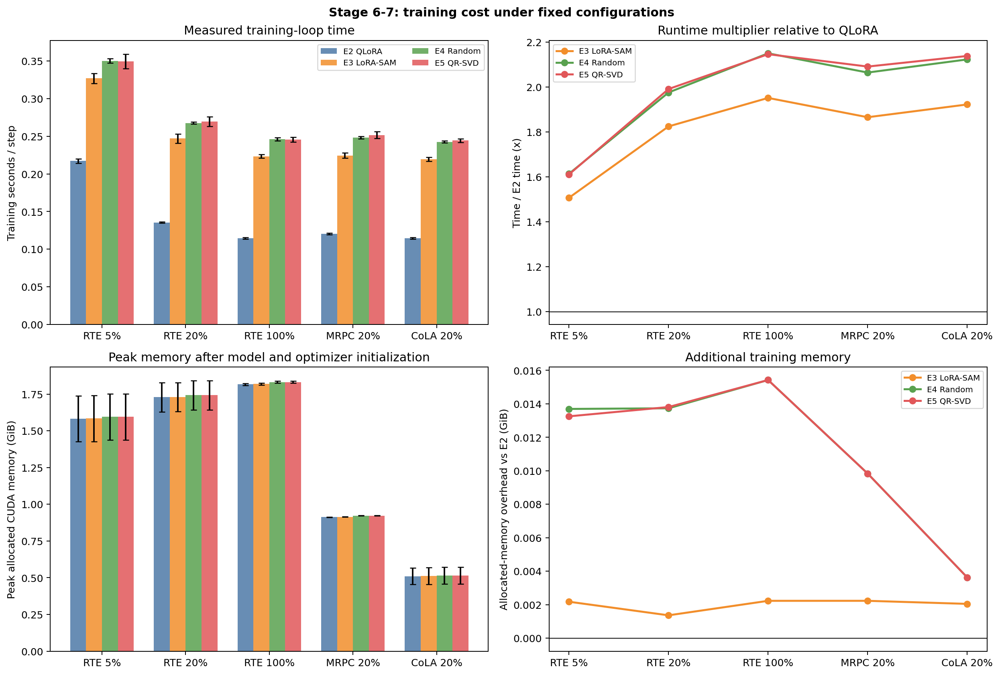

# Stage 6–7：正式五种子确认与任务扩展

## 1. 实验目的与固定配置

固定 Stage 2–5 选出的超参数，在 official validation 上完成 RTE 20% 正式确认，并扩展到 RTE 5%/100%、MRPC 20% 和 CoLA 20%。主要比较顺序为 `E5−E4`、`E5−E2`、`E5−E3`，同时报告训练时间与峰值显存。

| 项目 | E2 | E3 | E4 | E5 |
| --- | --- | --- | --- | --- |
| 方法 | QLoRA + AdamW | LoRA-SAM | Random-subspace SAM | QR-SVD-SAM |
| `rho` | — | **0.01** | **0.05** | **0.05** |
| 子空间 rank / 权重 `p` | — | — | **8 / 0** | **8 / 0** |
| Random basis | — | — | `12345, 2026, 3407` | — |

公共设置：4-bit NF4 RoBERTa-base，LoRA rank 8/alpha 16/dropout 0.05，query/value，AdamW `2e-4`，最多 20 epoch，patience 5，FP16，`deterministic=true`。Train seed 与 data seed 配对使用 `13, 21, 42, 87, 100`。

E4 在同一训练 seed 内先平均三个 random basis，再与 E5 做配对；不能把 15 个 E4 实例当作 15 个独立训练 seed。

## 2. 数据、指标与完整性

| Setting | Train / validation | 主指标 |
| --- | ---: | --- |
| RTE 5% | 124 / 277 | Accuracy |
| RTE 20% | 497 / 277 | Accuracy |
| RTE 100% | 2490 / 277 | Accuracy |
| MRPC 20% | 732 / 408 | `(Accuracy + F1) / 2` |
| CoLA 20% | 1709 / 1043 | Matthews correlation |

本阶段超参数已冻结，因此 official validation 用于 early stopping、最佳 checkpoint 选择和最终报告，不再依据本批结果调参。GLUE test 标签不可本地自动评估，故结论限定为 official-validation 结果。

| 检查项 | 结果 |
| --- | --- |
| 输出目录 | `records/stage67_formal_matrix_20261008_085232/` |
| 完整运行 | **150 / 150**；每个 setting 30 次 |
| 方法运行数 | E2/E3/E5 各 25；E4 75 |
| 确定性与数据配对 | 全部通过 |
| Official validation | 全部使用 |
| 固定 `rho/rank/p`、E4 basis 矩阵 | 全部通过 |
| NaN/Inf 与主指标一致性 | 无异常 |

## 3. 正式结果

表中数值均为五个训练 seed 的“主指标 × 100”均值 ± 样本标准差；MRPC 为 combined score，CoLA 为 MCC，并非 Accuracy。

| Setting | E2 | E3 | E4（三 basis 均值） | E5 |
| --- | ---: | ---: | ---: | ---: |
| RTE 5% | 53.79 ± 2.42 | **54.44 ± 2.08** | 54.37 ± 2.31 | 53.65 ± 2.10 |
| RTE 20% | 57.47 ± 3.61 | **58.27 ± 2.97** | 58.12 ± 3.04 | 57.76 ± 2.92 |
| RTE 100% | 73.36 ± 1.36 | **74.37 ± 1.02** | 73.89 ± 1.02 | 73.21 ± 1.18 |
| MRPC 20% | 85.72 ± 1.96 | 85.51 ± 1.93 | 85.55 ± 1.70 | **86.12 ± 1.44** |
| CoLA 20% | 50.31 ± 1.57 | 50.07 ± 2.28 | **50.82 ± 1.94** | 50.76 ± 1.33 |

MRPC 上 E5 的 Accuracy/F1 分别为 `83.73%/88.51%`，E2 为 `83.28%/88.16%`；两部分均仅小幅提高。CoLA 上 E5 Accuracy 为 `80.21%`，与 E2 的 `80.10%` 基本相同。

### 3.1 配对差异

| Setting | E5−E4 | E5−E2 | E5−E3 | E5 vs E4 胜/平/负 |
| --- | ---: | ---: | ---: | ---: |
| RTE 5% | −0.72 `[-2.25, 0.80]` | −0.14 `[-0.55, 0.26]` | −0.79 `[-2.81, 1.22]` | 0 / 2 / 3 |
| RTE 20% | −0.36 `[-2.64, 1.92]` | +0.29 `[-1.98, 2.56]` | −0.51 `[-2.80, 1.79]` | 3 / 0 / 2 |
| RTE 100% | −0.67 `[-1.77, 0.43]` | −0.14 `[-1.07, 0.79]` | −1.16 `[-3.29, 0.98]` | 1 / 0 / 4 |
| MRPC 20% | **+0.56** `[-0.30, 1.43]` | +0.39 `[-1.08, 1.87]` | +0.61 `[-0.80, 2.02]` | **5 / 0 / 0** |
| CoLA 20% | −0.07 `[-1.78, 1.65]` | +0.44 `[-1.82, 2.71]` | +0.69 `[-0.89, 2.27]` | 2 / 0 / 3 |

方括号为配对差异的探索性 95% CI，五个 setting 的全部三类区间都跨 0。MRPC 的 E5−E4 在 5/5 seeds 上为正，是唯一一致的方向信号，但均值仅 `+0.56 pp`，尚不足以支持跨任务机制结论。



## 4. 机制诊断

| Setting | E5/E4 投影梯度范数 | E5/E4 `perturbed−clean loss` | E4 basis 平均极差 |
| --- | ---: | ---: | ---: |
| RTE 5% | 0.34× | 0.42× | 0.51 pp |
| RTE 20% | 0.50× | 0.49× | 1.16 pp |
| RTE 100% | 0.60× | 0.60× | 2.45 pp |
| MRPC 20% | 0.57× | 0.56× | 0.90 pp |
| CoLA 20% | 0.46× | 0.46× | 1.70 pp |

相同 `rho=0.05、rank=8` 下，E5 的任务梯度投影只有 E4 的 `34%–60%`，增损也只有 `42%–60%`。这与 Stage 1 的“QR 方向弱于随机方向对齐”一致；扩大数据量没有消除该现象。MRPC 的小幅收益说明该方向可能具有任务依赖性，但不能解释为普遍有效的量化残差方向。

E4 的同 seed 三 basis 极差在 RTE 100% 达 `2.45 pp`、CoLA 达 `1.70 pp`，说明增强随机对照是必要的；单一随机实例会显著影响 E5−E4 结论。

## 5. 时间与显存代价

| Setting | E2 秒/step | E3/E2 时间 | E4/E2 时间 | E5/E2 时间 | E5 额外峰值 allocated 显存 |
| --- | ---: | ---: | ---: | ---: | ---: |
| RTE 5% | 0.2172 | 1.51× | 1.61× | 1.61× | +0.013 GiB |
| RTE 20% | 0.1355 | 1.82× | 1.98× | 1.99× | +0.014 GiB |
| RTE 100% | 0.1145 | 1.95× | 2.15× | 2.15× | +0.015 GiB |
| MRPC 20% | 0.1204 | 1.86× | 2.06× | 2.09× | +0.010 GiB |
| CoLA 20% | 0.1144 | 1.92× | 2.12× | 2.14× | +0.004 GiB |

E5 与 E4 的训练时间基本相同，但约为 E2 的 `1.61–2.15×`；额外常驻峰值显存不超过 `0.016 GiB`。计时从训练 loop 开始，包含验证与 checkpoint I/O 的摊销，但不包含模型加载和 QR-SVD basis 构建；显存记录也不包含 basis 构建期间的瞬时峰值。



## 6. 结论与 Qwen 决策

1. **QR 方向优势未得到正式确认。** `E5−E4` 仅 MRPC 为正；RTE 5/20/100% 和 CoLA 均为负，五个 setting 合计为 11 胜、2 平、12 负。
2. **E5 没有稳定改善 QLoRA 或 LoRA-SAM。** E5−E2 在三个 setting 为正、两个为负；E5−E3 仅 MRPC/CoLA 为正，三个 RTE setting 均为负；全部探索性区间跨 0。
3. **方向对齐问题仍是主要限制。** QR 投影梯度与增损持续显著弱于随机方向；更多数据、固定最佳 rank 和能量加权筛选均未解决该问题。
4. **当前不进入 Qwen。** 预设门槛要求 RTE 20% 的 E5−E4 为正，且四个扩展 setting 至少三个为正；实际分别为 `−0.36 pp` 和 `1/4`。在更大模型上复制当前构造预计只会放大约 2× 的训练时间，而缺少稳定收益依据。
5. 若继续研究，应先在 RoBERTa 上改变方向构造，例如引入任务梯度与量化残差的联合筛选或混合方向；在新机制重新通过 E5−E4 多任务门槛前，不开发 Qwen 版本或单步近似。

绘图脚本：`analysis/plot_stage67_formal_matrix.py`。复现命令：

```bash
python analysis/plot_stage67_formal_matrix.py \
  --run-dir records/stage67_formal_matrix_20261008_085232 \
  --output-dir reports/param_tuning/figures
```
