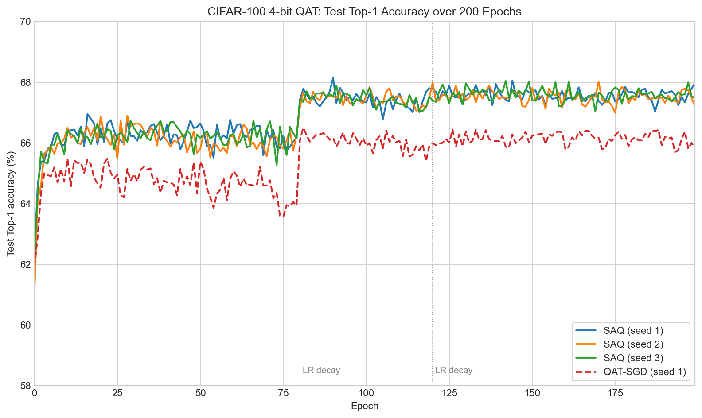

# SAQ-Reproduction

复现 **Sharpness-aware Quantization（SAQ）** 在 CIFAR-100 低比特训练中的表现，并增加普通 QAT-SGD 对照。工程基于[官方 SAQ 实现](https://github.com/zhuang-group/SAQ)，用于建立后续量化扰动方法的基线。

当前已完成 SAQ 的 3 个 seed 和 QAT-SGD 的 1 个 seed，每次均训练 200 epoch。完整原始日志、实际参数及逐 epoch 指标随工程归档。

## 方法与实验设置

普通 QAT-SGD 在量化模型上执行一次前向、反向和 SGD 更新。SAQ 在量化权重上构造邻域扰动，再进行第二次前后向，恢复临时扰动后更新参数；扰动前向期间冻结 BatchNorm running statistics。

| 项目 | 设置 |
|---|---|
| 任务 / 网络 | CIFAR-100 / PreResNet-20 |
| 初始化 | 同一 FP32 预训练模型 `r20_w32a32.pth` |
| 位宽 | 主干 W4A4；首层 W8A32；分类层 W8A8 |
| 优化器 | Nesterov SGD；momentum 0.9；weight decay 1e-4 |
| 学习率 | 初始 0.01；epoch 80、120 各乘 0.1 |
| 预算 | 200 epoch；batch size 128 |
| SAQ | `QSAM_SGD`，rho=0.4，`LIQ_wn_qsam` |
| 普通 QAT | `SGD`，rho=0，`LIQ_wn` |

## 已完成结果

下表的最佳 Top-1 为每次运行 200 epoch 内的最高测试准确率；末轮为 epoch 199。`±` 为跨 seed 样本标准差。

| 方法 | Seed | 最佳 Top-1 | 末轮 Top-1 | epoch 120–199 平均 Top-1 | 训练时间/epoch |
|---|---|---:|---:|---:|---:|
| SAQ | 1 | 68.14% | 67.96% | 67.57% | 约 37 s |
| SAQ | 2 | 68.01% | 67.20% | 67.52% | 约 36 s |
| SAQ | 3 | 68.04% | 67.47% | 67.59% | 约 36 s |
| **SAQ 汇总** | **1、2、3** | **68.06 ± 0.07%** | **67.54 ± 0.38%** | **67.56%** | **约 36–37 s** |
| 普通 QAT-SGD | 1 | 66.50% | 65.81% | 66.13% | 约 16 s |



SAQ 的平均最佳 Top-1 比当前 QAT 对照高 **1.56 个百分点**，后期平均 Top-1 高约 **1.43 个百分点**，训练开销约为对照的 **2.3 倍**。

这些是当前配置下的观察：QAT-SGD 只有 seed 1，不能将差值解释为严格的多 seed 显著性结果；两条路径分别使用 QSAM 和普通 QAT 量化模块。现有精度曲线也不能直接证明损失曲面的平坦性。详细机制、日志分析和局限见[完整报告](reports/reproduction_report.md)。

## 目录与记录

```text
SAQ-Reproduction/
├── train_sam.py                 # QAT/SAQ 训练
├── engine.py, qconfig.py        # 训练循环与参数
├── core/, models/, quan_models/, utils/
├── scripts/run_experiment.py    # 可配置运行入口
├── analysis/                   # 根据日志重新绘图
├── records/                    # 4 次完整运行的日志与参数
└── reports/                    # 分析报告与图表
```

[运行清单](records/runs.json)记录每次实验的位置。各 run 内的 `experiment.log` 为原始文本日志，`settings.log` 为实际设置，`log.txt` 为 200 行逐 epoch 数值。历史服务器路径保留原值；当前运行入口不依赖这些路径。

## 安装与训练

使用 Python 3.10 或更高版本，先安装与设备匹配的 PyTorch/torchvision，再安装依赖：

```bash
cd SAQ-Reproduction
python -m pip install -r requirements.txt
```

自行准备 CIFAR-100 和上述 FP32 初始化模型；预训练模型来源见[上游 Model Zoo](https://github.com/zhuang-group/SAQ/wiki/Model-Zoo)。数据布局应为 `<DATA_ROOT>/cifar/cifar-100-python/{train,test,meta}`。

```bash
python scripts/run_experiment.py --method saq --seed 1 2 3 --data-root /path/to/data --pretrained /path/to/r20_w32a32.pth
python scripts/run_experiment.py --method qat-sgd --seed 1 --data-root /path/to/data --pretrained /path/to/r20_w32a32.pth
```

可用 `--gpu`、`--output` 指定设备和新输出位置；`--print-command` 仅检查训练参数。默认新输出写入被忽略的 `runs/`。本项目不包含数据或权重，依赖清单也不等于原实验环境的完整锁定。

## 从归档日志重新绘图

在本项目根目录执行，不需要数据集或模型权重：

```bash
python analysis/plot_test_accuracy_curves.py
python analysis/plot_loss_curves.py
```

图表输出至 `reports/figures/`。后续残差子空间实验见同级 [QR-SVD](../QR-SVD/README.md)；该项目复用这里的 SAQ 基线记录。

## 来源与许可

论文：[*Sharpness-aware Quantization for Deep Neural Networks*](https://arxiv.org/abs/2111.12273)，Jing Liu、Jianfei Cai、Bohan Zhuang。上游 Apache-2.0 [LICENSE](LICENSE) 保持原样；本地修改与来源见 [NOTICE.md](NOTICE.md)。本工程为复现和扩展工程。
