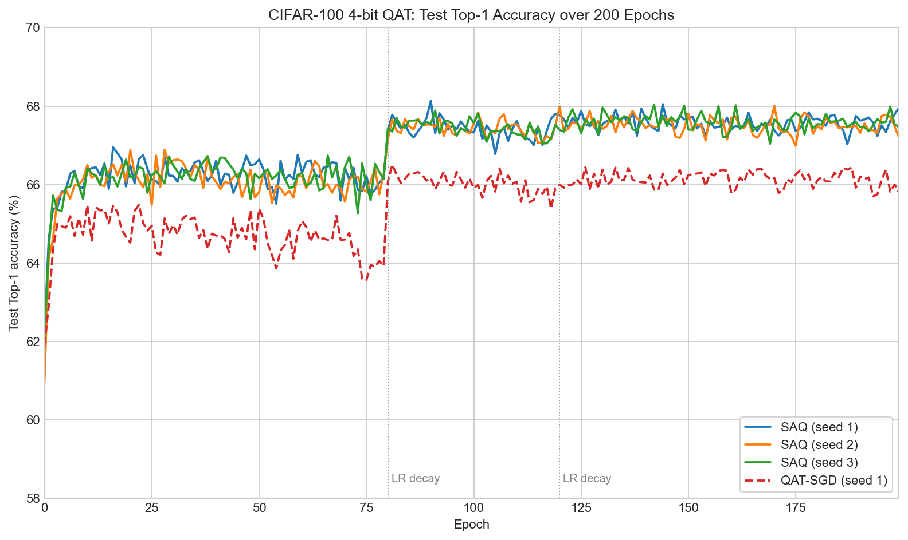

# SAQ 复现实验笔记

## 结论摘要

在本次 CIFAR-100、4-bit 量化 PreResNet-20 的复现实验中，SAQ（`QSAM_SGD`）在测试集上表现出更好的泛化能力：三个随机种子的平均最佳 Top-1 为 **68.06 ± 0.07%**，相较当前普通 QAT-SGD 基线（66.50%）高 **1.56 个百分点**。这种优势不仅出现在单个最佳 checkpoint，在训练后期和末轮测试准确率中也持续存在。


## 实验设置

| 项目 | 设置 |
|---|---|
| 数据集 | CIFAR-100（训练集 50,000 张，测试集 10,000 张） |
| 骨干网络 | PreResNet-20 |
| 量化配置 | 权重 4 bit、激活 4 bit；首层为 W8A32 |
| 训练轮数 / batch size | 200 / 128 |
| 初始学习率 | 0.01 |
| 学习率策略 | Multi-step；在 epoch 80、120 后衰减，末轮为 0.0001 |
| SAQ 优化器 | `QSAM_SGD`，`rho=0.4` |
| 基线优化器 | `SGD`，`rho=0` |
| 随机种子 | SAQ：1、2、3；SGD：1 |


## 实验原理

### 1. 量化训练、SAM 与 SAQ 的目标

记浮点权重为 $w$，权重量化器为 $Q_w(\cdot)$，量化误差为 $\epsilon_q(w)=Q_w(w)-w$，训练损失为 $\mathcal L$。普通 QAT 实际优化量化后的模型：

$$
\min_w \mathcal L(Q_w(w)).
$$

但量化的裁剪和离散化会使损失曲面更尖锐：浮点权重的微小变化可能跨越量化级别，从而引起量化权重与损失的突变。标准 SAM 则在参数邻域中寻找最坏方向，并在该方向上的损失下降：

$$
\epsilon_s^*(w)=\rho\frac{\nabla_w\mathcal L(w)}{\lVert\nabla_w\mathcal L(w)\rVert_2},
\qquad
w\leftarrow w-\eta\nabla_w\mathcal L(w+\epsilon_s^*(w)).
$$

SAQ论文指出，直接将 SAM 加到 QAT 上会有两个问题：若扰动按浮点权重的梯度构造，梯度经过量化/裁剪后会发生 **perturbation mismatch**；若先扰动浮点权重再量化，小扰动可能没有改变任何离散码字，即 **perturbation diminishment**。

于是，SAQ 论文中的 Case 3 采用先量化、再在量化权重空间构造扰动：

$$
\min_w\mathcal L\bigl(Q_w(w)+\epsilon_s^*(Q_w(w))\bigr),
\qquad
\epsilon_s^*(Q_w(w))=
\rho\frac{\nabla_{Q_w}\mathcal L(Q_w(w))}{\lVert\nabla_{Q_w}\mathcal L(Q_w(w))\rVert_2}.
$$

本实验 `QSAM_SGD` 实现的核心：最坏方向由**量化后权重**的梯度产生，且扰动直接加在量化权重上，因此不会被下一次量化操作抹去。


### 2. `QSAM_SGD` 的一次 mini-batch 更新

下面的伪代码对应 [`engine.py`](../engine.py) 的训练循环及 [`utils/qsam.py`](../utils/qsam.py) 的 `ascent_step` / `descent_step`：

```text
# 第一次前后向：在未扰动的量化模型上寻找最坏方向
z = Q_w(w)
g_Q = ∇_z L(z)
epsilon = rho * g_Q / ||g_Q||_2

# 第二次前后向：量化权重加扰动，不重新量化 epsilon
g_perturbed = ∇_w L(Q_w(w) + epsilon)

# 恢复被临时修改的 clip/BN 参数，再由 Nesterov SGD 更新浮点参数
w <- SGD(w, g_perturbed)
```
### 3. 与普通 QAT-SGD 的方法差别

普通 QAT-SGD 对每个 mini-batch 只执行一次 `Q_w(w) → loss.backward() → SGD.step()`，没有内层最坏扰动、第二次前后向或 `epsilon`。因此两组实验的比较检验的是：在相同低比特 QAT 设置下，是否值得额外优化量化权重邻域的最坏损失。


## 实验过程及分析：SAQ优化器-SGD基线优化器对比
共进行了四组实验，包括seed=1，2，3的SAQ复现，以及seed=1的SGD基线复现。SAQ复现直接使用官方的源码；由于官方没有SGD对照实验，我们想直观感受SAQ的泛化性优势，所以创建了一个新分支对实验代码进行微调：

- 新增普通 QAT-SGD 训练路径，改用无 `epsilon` 的 `qpreresnet20` / `LIQ_wn` 量化层，并将每个 batch 的“双前后向 + QSAM 更新”替换为“一次量化前后向 + Nesterov SGD 更新”。
- 除方法相关部分外，保持 CIFAR-100、全精度预训练初始化、W4A4（首层 W8A32）、batch size 128、初始学习率 0.01、动量 0.9、weight decay \(10^{-4}\)、200 epoch 和 epoch 80/120 学习率衰减一致。
- SGD 基线取 `rho=0`、seed=1。

下面是跑完训练后根据日志(`experiment.log`)提取的结果：

| 方法 | Seed | 最佳 Top-1 | 最佳 Top-5 | 最优 epoch | 末轮 Top-1 | epoch 120–199 平均 Top-1 | 每 epoch 训练时间 |
|---|---:|---:|---:|---:|---:|---:|---:|
| SAQ / QSAM-SGD | 1 | 68.14% | 90.97% | 90 | 67.96% | 67.57% | 37 s |
| SAQ / QSAM-SGD | 2 | 68.01% | 91.10% | 170 | 67.20% | 67.52% | 36 s |
| SAQ / QSAM-SGD | 3 | 68.04% | 90.99% | 142 | 67.47% | 67.59% | 36 s |
| **SAQ / QSAM-SGD（3-seed mean）** | — | **68.06 ± 0.07%** | **91.02 ± 0.07%** | — | **67.54 ± 0.38%** | **67.56%** | **36–37 s** |
| 普通 QAT-SGD | 1 | 66.50% | 90.19% | 81 | 65.81% | 66.13% | 16 s |




图中每一个点都是该 epoch 训练完成后在 CIFAR-100 测试集上的 Top-1 准确率。它直接衡量模型对未参与训练样本的预测能力。虚线标出 epoch 80 和 120 的学习率衰减点。

#### 曲线解读

- 三条 SAQ 曲线在训练后期集中于约 67.5%–68.0%，彼此非常接近；其最佳 Top-1 的样本标准差仅 0.07 个百分点，说明当前设置下具有较好的种子稳定性。
- 在 epoch 80 首次学习率衰减后，SAQ 的测试准确率整体跃迁至约 67% 以上，并持续高于 SGD 曲线。
- 最优 checkpoint 分别出现在 SAQ 的 epoch 90、170、142，而不总是最后一轮。因此应使用日志记录的 best checkpoint 汇报最佳结果，不应默认使用 epoch 199 checkpoint。
- SAQ 的训练开销约为 36–37 秒/epoch，普通 SGD 约为 16 秒/epoch，即约 **2.3 倍**。可见SAQ方法需要额外消耗训练成本。


#### SAQ 具有更好的泛化性

泛化能力以模型在未见测试数据上的表现来判断。本次日志有三项相互补充的证据：

1. **最佳测试精度更高。** SAQ 三个 seed 的平均最佳 Top-1 为 68.06%，比 SGD 高 **1.56 个百分点**；Top-5 也高 **0.83 个百分点**。
2. **后期优势持续存在。** 在第二次学习率衰减后的稳定阶段（epoch 120–199），SAQ 的平均测试 Top-1 为 67.56%，比 SGD 高 **1.43 个百分点**；末轮平均测试 Top-1 也高 **1.73 个百分点**。优势并非来自一次偶然的峰值。
3. **训练—测试差距更小。** epoch 199 时，SAQ 三个 seed 的平均训练 Top-1 约为 88.46%、测试 Top-1 为 67.54%，泛化差距约 **20.92 个百分点**；SGD 为 89.82% 与 65.81%，差距为 **24.01 个百分点**。即使 SGD 对训练集拟合得更充分，SAQ 对测试集的表现更好，且训练到测试的性能落差约小 **3.09 个百分点**。

这与 SAQ/SAM 的动机一致：它不以最低训练 loss 为唯一目标，而倾向于位于更平坦、对参数微小扰动不敏感的区域，从而改善测试泛化。


## 后续可加强的机制验证

若要直接验证“平坦性”机制，可从各方法的最佳 checkpoint 出发，对权重施加不同半径的归一化随机扰动，并绘制测试 loss 或测试 Top-1 随扰动半径变化的曲线。若 SAQ 在相同扰动下精度下降更慢、损失上升更慢，即可直接支持其 sharpness-aware 的解释。

当前日志未保存该扰动扫描结果，因此不能仅由现有日志直接得出平坦性结论；它是建议补充的实验，而非本报告已经验证的事实。

## 严谨性与局限

- 当前 SAQ 有 3 个 seed，而 SGD 只有 seed=1。上述结果支持 SAQ 泛化更好的初步结论，但尚不能构成严格的多 seed 显著性比较。
- 建议以相同的 seed=1、2、3 补跑 SGD，并采用相同的数据顺序、checkpoint 选择规则和量化配置。之后可绘制“均值测试 Top-1 曲线 ± 标准差阴影”，并在主表中报告两种方法的 mean ± std。
- 两组日志分别使用 `qsampreresnet20` / `LIQ_wn_qsam` 和 `qpreresnet20` / `LIQ_wn` 实现；后续需核对二者除 SAQ 优化逻辑外的网络和量化细节完全一致。

